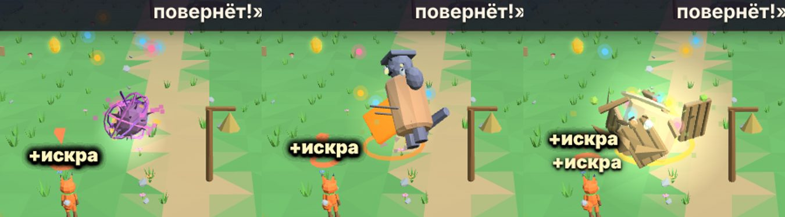

# Бой

В «Златой цепи» нет злодеев, которых убивают. Все враги — **мороки**: нитяные клубки в облике существ. Удар их **распутывает**, а не ранит; живые существа мороками не бывают. Язык боя один на всю игру: **сигнал → защита → запал гаснет → Пробой → удар**.

## Сигналы мороков
Перед ударом над мороком загорается знак. По нему понятно, как защищаться.

| Сигнал | Как выглядит | Что делать |
|---|---|---|
| 🟡 **Жёлтый** | жёлтое солнышко | **щит** (G / . / B) в такт удару — и сразу ответный удар |
| 🔴 **Красный** | красный зубец | щит не держит — **уйти в сторону или кувырок** (Shift / / / LT) |
| 🔵 **Синий** | синяя капля летит в героя | **отбить** её обратно щитом — морок получает свою же каплю |

Уворот — рывок (у каждого героя свой, см. [[Герои]]), на время рывка герой неуязвим. Рывком увернулся от удара — морок открыт на **3 секунды**: над ним крутится звёздочка, и бить можно с любой стороны.

У каждого сигнала свой звук: жёлтый — **бубенец**, красный — **рык**, синий — **«бульк-вжух»**. За миг до удара у морока сверкает
**звёздочка** с «дзинь» — это и есть момент для щита. **Нить и кольцо** цвета игрока показывают, на кого он замахнулся.

## Как чувствуется удар
- Попал — игра на миг **замирает** (80 мс; кора — 100, добивание — 110), морок целиком **белеет** на несколько кадров и сжимается,
  камеру толкает по направлению удара. Звук — сухой щелчок точно в кадр контакта, а дальше у каждого героя свой: Потап бьёт
  глухо и тяжело, Пелагея — со звоном, Йоша — звонко и легко.
- **Искры летят туда, куда пришёлся удар**, и похожи на самого морока: у нитяных — нитки и золотые искры, у водяных — брызги,
  у лесных — листья и щепки, у огненных — угольки и зола, у светлых (тень, тучка, мотылёк) — звёздочки, которые всплывают.
- Морока **отбрасывает** от героя (большого — чуть-чуть, летящего — нет), героя на земле слегка отдаёт назад.
- Погас последний уголёк — морок **раздувается, как шарик**, мигает белым и лопается: волна, конфетти его цветов и «Хлоп!».
- «Вспышки» в настройках: 50 % — белое короче, 0 % — без белого силуэта.
- Удары подряд звучат **лесенкой**: каждая нота выше прежней (так же звенят звенья, собранные подряд).
- Ударили вдвоём разом — **«Вместе!»** и общий аккорд; две плиты нажаты вдвоём — тоже аккорд.

## Как чувствуется выстрел морока
Синяя капля мороков-стрелков (нитяной, пузырник, щука, жар-ящерка и др.) сделана по восьми шагам «магической атаки»:
- **Заряд**: пока морок замахивается, капля собирается у него над головой, к ней стягиваются искорки, гул нарастает. Видно, откуда и когда полетит.
- **Полёт**: у капли белое ядро и ореол, она пульсирует и тянет за собой шлейф. На вылете слышно «вжух».
- **Попадание**: вспышка и искры по направлению полёта, глухой «бум». В щит — звонкое «дзинь» и веер искр назад.
- **Отбитая капля** летит назад с золотым шлейфом. Когда она попадает в морока, игра на миг замирает, морок белеет, сжимается и отъезжает,
  потом ещё секунду на нём тлеет пятно с искорками. Над ним выскакивает упругое «−1», а потеря сразу нескольких угольков («Сама себя!») — крупное золотое число.
- «Вспышки» и «Тряска» в настройках действуют и здесь: 0 % — без вспышек и тряски, остальное остаётся.

## Запал и Пробой
- Над мороком горят **угольки** — его запал. Каждая удачная защита и каждый удар гасят уголёк.
- Погасли все — **Пробой**: морок оглушён и беззащитен. Бейте (F / , / X) — он распутывается.
- У больших мороков есть **скорлупа** (кора, латы): она слетает с той стороны, откуда пришёл удар.
- Огромный Пробой босса бьют **вдвоём** — **Богатырский мах**.

## Как морок распутывается
Последний мах не «выключает» морока, а распутывает его: он на миг вытягивается и зажмуривается, потом **рассыпается на лёгкие осколки**, которые разлетаются, прыгают по земле и сжимаются в ничто. Вид смерти зависит от семейства:
- **нитяные** (клубок, нитяной морок, тать, ворона, пугало, хамелей) — кольца нити взлетают винтом;
- **водные** (щука, рак, тинник, тягун, пузырник) — брызги и круги по воде;
- **лесные** (кикиморка, лешачонок, пень, рука Лешего) — листья и щепки;
- **огненные** (болван, печник, змеёныш, ящерка) — угольки и зола;
- **светлые** (тень, тучка, мотылёк) — рассыпаются в искры и плывут вверх.

Большой морок перед смертью дрожит и светится, на хлопке на миг замирает, и от него идут два кольца. Осколки — только украшение: на ход боя они не влияют, а после смерти исчезают за секунду.

## Одна кнопка защиты
Кнопка защиты делает всё: короткое нажатие — **щит**, нажатие в момент удара — **отбив**, серия отбивов подряд — **«Одним махом»**. Щит не держит красное, а широкий щит [[Потапа|Потап]] закрывает тех, кто стоит у него за спиной.

**Богатырский щит** — оба игрока жмут защиту в одну долю. Он держит то, что одному не удержать: волну-вожака, большую волну Соловья, шары Кощея.

## Искры и богатырский выход
Распутанные мороки оставляют **искры** — их подбирают, а мороки стараются их «сжевать». Искры наполняют **синюю шкалу** (у каждого игрока своя). Как только она полна, богатырский выход включается **сам** — жать ничего не нужно, — и сила достаётся **сразу обоим героям игрока**: вдвоём работают их выходы, а Смена героя их не сбрасывает. Пока выход идёт, та же шкала **золотая, светится и медленно убывает до нуля** — по ней видно оставшееся время (в последние 2 с она мигает). Искры, пойманные за это время, копятся незаметно и покажутся на шкале, когда сила кончится.

| Герой | Богатырский выход | Действует |
|---|---|---|
| [[Прошка]] | **Меч-кладенец** — меч сам рубит ближних | 12 с |
| [[Потап]] | **Медвежья сила** — каждый удар ломает скорлупу, сам неуязвим | 12 с |
| [[Пелагея]] | **Вещий взор** — мороки вдвое медленнее | 10 с |
| [[Йоша]] | **Живой родник** — всем по лепестку, упавшие встают; у кого лепестки полны — **запасной лепесток** (голубой, сгорает первым) | сразу (сияет 2 с) |

**Как видно, что сила включилась.** Пока шкала набирается (от 70%), она дрожит, на герое вспыхивают голубые искорки, каждая искра звенит выше.
Выход — мир на миг замирает, камера делает наезд, над **каждым** героем игрока бьёт столб света в цвете героя, от них расходится волна —
ближние мороки отшатываются (обычные, не большие), а герой выкрикивает свой клич. Пока сила идёт:
- у ног героя крутится **круг-оберег** его цвета, над головой — **знак силы**: меч (Прошка), лапа (Потап), глаз (Пелагея), капля (Йоша).
  Знаки есть и у героя, который идёт вторым: сила у обоих. В последние 2 с знак и круг мигают, потом осыпаются искрами — «Сила ушла»;
- **Прошка** держит светящийся клинок; Кладенец рубит золотой широкой дугой с надписью «Кладенец!» — и у Прошки, который идёт вторым;
- **Потап** становится крупнее, его шаги пылят; удар морока отскакивает со звоном и надписью «Не берёт!», морок отшатывается;
  скорлупа от его ударов слетает с тяжёлым звоном;
- **Пелагея** — в венце, от неё расходится тихая рябь; все мороки голубеют, над ними висят песочные часы, их сигналы звучат с низким эхом;
- **Йоша** — фонтан брызг, к каждому герою летит капля, лепестки в панели вспыхивают; «Встал!» — у поднятого.

В панели игрока портреты героев с силой — в рамке её цвета, со значком и кольцом-таймером; у друга под панелью — строка о том,
что дал выход («Пелагея: мороки вдвое медленнее», «Йоша: всем по лепестку»). Если выход случился, пока у друга ещё идёт свой, —
**«Богатырская дружина»**: второй горн, общее кольцо и **+2 с** всем силам обоих игроков.

## Лепестки и подшивание — «закон доброго дивана»
- У каждого игрока **три лепестка** (розовые над панелью). Удар морока или опасность мира снимает один; друг друга герои задеть не могут.
  Ударили — край экрана этого игрока розовеет, лепесток слетает и падает на землю; на последнем лепестке слышно тихое сердцебиение.
- Лепестки кончились — герой «рассыпался клубком ниток» и садится. Подойдите к нему **любым своим героем** и постойте рядом секунду — **«Подшили!»**: он встаёт с двумя лепестками.
- Никто не подошёл — через 10 секунд герой сам встаёт у последнего колокольчика со всеми лепестками.
- Пока игрок «рассыпался», в игре вдвоём он ничего не нажимает (до 10 секунд); в одиночном режиме можно сменить героя. Упавший видит подсказку «Ты отдыхаешь — не страшно!», а друг — «Подойди, рядом постой».
- **Падения без урона**: упал в пропасть или в ряску — вернёшься к колокольчику, лепестки на месте.

## Сложность
Путь выбирает каждый игрок сам (экран «Кто играет?» при новой игре, потом «Настройки»): **Лёгкий**, **Средний**, **Богатырский**. Сложность меняет окно защиты, скорость мороков и длительность Пробоя. Для общих действий действует **закон щедрого окна**: засчитывается окно того, у кого оно шире.

### Детские настройки Лёгкого и Среднего пути
Для 🦔 Ёжика и 🦊 Лисёнка в прологе и мире 1 окна шире (подробно — [[Мир-1-Дремучий-лес]]); в **мирах 2 и 3 они сходят плавно** (замах 0,82 / 0,76 с вместо 0,9, отбив 0,38 / 0,37, Пробой 8 / 7 с, красный знак дольше на 35 % / 20 %), в **мирах 4–5** (в том числе на боссах) — ступень боссов: замах Ёжика 0,9 с (у головы Горыныча ×1,25), красный знак дольше в 1,5 раза (Средний — в 1,2), кувырок засчитывается за 0,8 с до удара, подсказки живут в 1,5 раза дольше, Средний путь — со своим замахом ≥ 0,8 с у голов. Богатырский путь везде без поблажек. Там, где действуют эти настройки:
- **Первые шесть** (а не три) встреч с каждым знаком у Ёжика идут в замедлении и с кнопкой рядом;
- **«Жалость»:** щит три раза подряд без отбива — морок выдыхается и открывается для удара (Ёжик);
- **Синяя капля** летит медленнее (5,5–5,9 вместо 6,5), окно отбива шире на 0,05–0,07 с, у Ёжика не больше двух стрелков на игрока одновременно;
- **Красный знак:** пока у игрока не вышел первый кувырок, подсказка «кувырок» повторяется на каждом красном замахе, а у Ёжика замах идёт в замедлении;
- в прологе щит у Ёжика не расходует «дух».

## Лестница подсказок при промахах
Если приём не выходит, игра помогает по ступеням (`FIN.help`; для каждого игрока и каждого приёма — «щит», «кувырок» — счёт свой, успех сбрасывает его):
1. **Первый промах** — кнопка приёма над героем мигает и звякает.
2. **Второй промах или 12 с без успеха** — карточка не длиннее 7 слов («Щит — жми G в последний миг»), стрелка на цель и чтение вслух.
3. **Третий промах или 20 с** — герои показывают приём (до 8 с), а 20 с враг этого игрока медленнее ×0,7 и окно отбива шире ×1,3.
4. **Два падения без успеха** — «повтор урока» (шаблон урока — отдельная задача).

Путь «Богатырь» идёт без поблажек: ступеней 3–4 нет. «Лисёнок» получает их вдвое слабее (×0,85 / ×1,15), «Ёжик» — полностью. Пока лестница подключена к 1-Б (щит и кувырок), остальные боссы подключаются по очереди.

## Противник подсматривает
Некоторые мороки (чугунные болваны, тени-двойники, средняя голова Горыныча) запоминают любимую защиту: три-пять одинаковых защит подряд — и сигнал меняется на тот, против которого она бесполезна. Чередуйте приёмы.

## Камера в бою
Как только рядом есть морок, экран не делится, даже если игроки разошлись. На узких аренах, на палубе и во всех гусельных уровнях экран общий всегда. Там, где головоломка на двоих (плиты калитки в 1-1, засов в 1-5), экран тоже общий, пока оба героя у головоломки.

См. также: [[Бестиарий]], [[Боссы]], [[Глоссарий]].

## Язык сигналов
У боссов один язык предупреждений: **цвет + форма + звук** говорят, что делать. Жёлтое солнышко на земле — «щит в последний миг» (бубенец); красный зубец или веер — «кувырок, в сторону» (рык); синяя капля — «отбей назад»; низкая белая полоса — «прыжок»; синий купол-тень — «за щит Потапа»; золото — только хорошее: «вместе», «цель», «окно, бей». **Опасность никогда не золотая.** Таблица живёт в коде (`FIN.signals`), а бот `tfin_signals` следит, чтобы в новых боях цвета её не нарушали; цвета старых боёв (скакалка 1-Б, волны 3-Б) приведут к ней позже.
