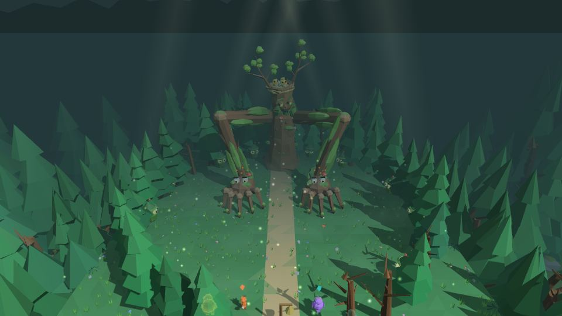
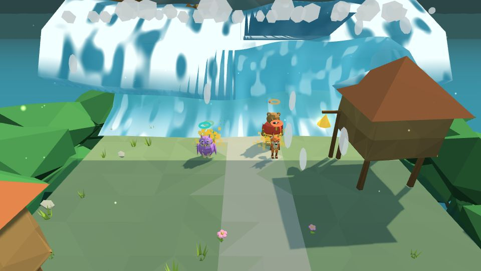
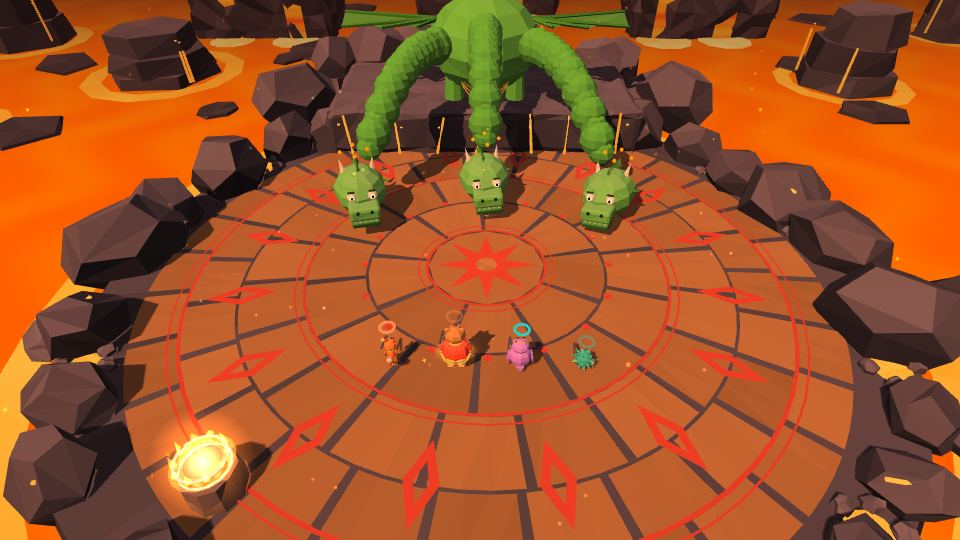
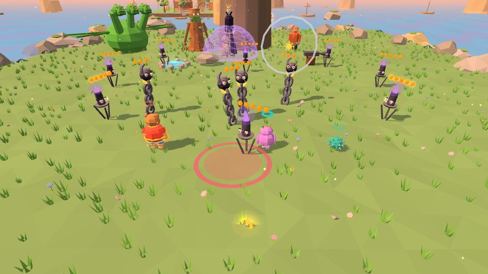

# Боссы

В конце каждого мира — босс. Боссы в «Златой цепи» не злодеи: это существа, которых закружил морок или обида. Победить — значит распутать, успокоить или договориться. У каждого босса над головой подсказка, что делать прямо сейчас.

| Мир | Босс | Уровень | Награда |
|---|---|---|---|
| 1 | 🌲 [Леший-Путаник](#-леший-путаник) | 1-Б | Сказ 1, первая цепь на дубе |
| 2 | 🌊 [Водяной](#-водяной) | 2-Б | Сказ 2 «Колокола Китежа» |
| 3 | 🐦 [Соловей-Разбойник](#-соловей-разбойник) | 3-Б | Сказ 3 «Соловьиная песня» |
| 4 | 🐉 [Змей Горыныч](#-змей-горыныч) | 4-Б | Горыныч — друг и ездовой змей, Сказ 4 «Одно сердце» |
| 5 | 💀 [Кощей Бессмертный](#-кощей-бессмертный-) | 5-Б1, 5-Б2 | Златая цепь, финал 🔒 |

Ворота к боссу открываются, когда Кузьма скуёт **12 звеньев** мира (на Буяне — 9 из 15 на терем). См. [[Экономика]].

---

## 🌲 Леший-Путаник

**Уровень:** 1-Б · **Мир:** [[Дремучий лес|Мир-1-Дремучий-лес]]

Бой — **экзамен по миру**: в нём только то, чему учил Дремучий лес, и подписи этапов это напоминают («щит, как от кикиморок», «кувырок, как от пня», «струна на колышках — как на болоте», «бегите вокруг Лешего, как ёлки хороводом»). Вступление начинается **подходом**: камера идёт по тропе к поляне мимо трофеев Лешего — моховых шапок на пнях, лент на ветках, указателей «по кругу»; за героями тропу заваливает бурелом.

- **Руки-коряги**: бьют по очереди. Левая «Хлоп» (жёлтая) — вскидывает ладонь, заливается круг: щит в последний миг; правая «Сгреб» (красная) — метёт дугой, заливается веер: кувырок или шаг за край. Не достала — ладонь увязла, бейте. Рука в Пробое остаётся на плече Лешего и сама **опускается мостиком** к ладони на земле (10 с), по ней взбегают на плечо; потом так же плавно поднимается обратно. Пробиты обе — мостов два, каждая рука на своём плече, и ни одна не отваливается и не пропадает.
- **Двойники «Ищи-свищи»**: двойники прячутся — перебегают к ёлкам, выглядывают («Ку-ку!») и каждые 9–12 с меняются местами в клубах дыма. Настоящего выдают тень, дыхание и мох-следы на траве; **Совиный взор** [[Пелагеи|Пелагея]] надевает на него золотой обруч. Струна по ногам запутывает двойников, упавший настоящий лежит 6 с — бейте его; найденный исчезает в клубах шишек вместе с остальными двойниками, на хоровод никто не остаётся.
- **Хоровод**: Леший встаёт на пень и крутит скакалку. Оба героя бегут по дорожке вокруг пня и **перепрыгивают** верёвку — под лианой белая полоса, впереди бледный белый веер: прыжок (кувырок тоже годится): по два витка на каждого — за виток зажигается фонарик. За каждым героем тянется своя лента (оранжевая и синяя): она живая, колышется на бегу и **мотается на ствол Лешего витками вверх** — две ленты, как двойная резьба; побежал назад — лента сматывается, при «Тяни-потяни» — стягивается и светлеет, а после маха сходит к героям. Потом «Тяни-потяни»: оба жмут удар на «ТРИ!», и Леший запутывается; **Богатырский мах** вдвоём. Круг 2 — две скакалки и шарманка быстрее. Одним игроком: второй герой «держит ленту» — стоит на месте, а «Тяни-потяни» и мах — одним нажатием. Перед первым кругом — короткий урок: герои сами бегут по стрелкам вокруг Лешего, и ленты мотаются на ствол; потом скакалка пролетает, герои прыгают; «раз-два-ТРИ» — бьём вместе. Пропустить может один игрок (держать прыжок 2 секунды), «Показать урок ещё раз» — в паузе.
- **Облик**: Леший ростом с ель — гнездо с птенцами на голове, рога с листьями, борода-мох; три удара по макушке сбивают их по одному, и он то удивляется, то обижается, то смущается. Руки-коряги — большие «пауки» от плеч Лешего (руки всегда на плечах: в Пробое опускаются мостом, после этапа руки Лешего на месте), заливка круга на земле показывает, куда ударит ладонь. Арена меняется по этапам: сумерки, ночь со светляками, ярмарка с фонариками, рассвет; из-за ёлок выглядывают лешачата. У каждого этапа своя музыка (тяжёлая — руки, пиццикато — прятки, вальс-шарманка — хоровод, колыбельная — финал); вход, переходы и финал — отдельные ролики.
 

## 🌊 Водяной

**Уровень:** 2-Б · **Мир:** [[Подводный Китеж|Мир-2-Подводный-Китеж]]

Это он сорвал язык главного колокола Китежа и бросил его в море, чтобы город молчал (так говорит Садко в финале 2-1). Его жёлтые глаза светятся в тёмной воде за рифом с первого уровня мира.

Сначала — **погоня с валом** (≈190 м) в грозовой вечер: небо сизо-лиловое, дождь идёт за героями, впереди бьют молнии; вал — из сказочной воды гуслей, с золотыми искрами и нотами в толще. Деревня на сваях (котёнок едет до омута), дуб, мельница (Потап держит колесо), кувшинки в лад, ручей, развилка со шлюзом, камыш, лодка Садко и прыжок с обрыва.

Бой с дедушкой Водяным в четыре этапа:
1. **Сом-перевозчик** — сом бросается на мель, [[Прошка]] сбивает ус рогаткой, [[Потап]] тянет «раз-два-три».
2. **Водяные кони** — сыграл у раковины, конь замер, на него садится другой — на остров, удар по короне.
3. **Омут-зеркало** — Совиный взор, метка рогаткой, кувшинка-плот.
4. **Великий вал** — колокола Китежа на «БОМ!», вал расступается, общий удар.

Каждый новый приём этапов 1–3 сначала показывает короткий урок (до 25 с, один приём — один урок: ус, тяга, конь, три роли; пропуск — оба держат прыжок, «Показать урок ещё раз» — в паузе).

**Оба рассыпались — назад к отметке:** герои возвращаются ко входу, но сила Водяного (угольки) и раскрытые кувшинки не возвращаются — этап продолжается с того же места.

Музыка этапов выровнена по громкости: у каждого этапа свой барабанный рисунок вместо общего. В финале колокола вызванивают напев Садко.

В одиночку работает «оставленный держит» (8 секунд); на этапе 2 в одиночку у Водяного вдвое меньше угольков. Колокола Китежа убаюкивают Водяного.
 

## 🐦 Соловей-Разбойник

**Уровень:** 3-Б · **Мир:** [[Небесное царство|Мир-3-Небесное-царство]]

Сначала — **подход «Прямоезжая дорожка»** (≈170 м): Соловей свистит издалека, свист сдувает стоящих на открытом — прячься за камни, деревья и за щит [[Потапа|Потап]]. Колода поперёк дорожки (Потап откатывает), травы-муравы (Йоша поливает тропку), мост из лепестков и мост из поклонившихся деревьев (после свиста), застава дочек-соловушек (Потап держит подворотню, подушки сбивает [[Прошка]]), тающие облачка, уступы дуба-сторожа и калитка в ободе гнезда. Ждёте у прорехи — Соловей свистит сразу, мост встаёт без ожидания. Дорожку прошли один раз — при повторе уровень начинается у гнезда.

Бой по былине — «свистит по-соловьиному, кричит по-звериному, шипит по-змеиному»; над Соловьём табличка «что делать сейчас»:
1. **Свист соловьиный** — белая волна (прыжок), синяя (за широкий щит Потапа); щёки дует — [[Йоша]] под щитом плещет ему в клюв. Второе дыхание: дуб кланяется — Йоша поливает корни, другой дёргает Соловья за хвост.
2. **Крик звериный** — ночь, звери-тени; свет пера одного и щит другого — «солнечный зайчик» в глаза, Соловей падает — в свете пера бей.
3. **Шип змеиный** — ветряные змеи, перья-стрелы, пике; Потап подкидывает друга в вихрь — родео на Соловье (наклоняйся против крена); мёртвая петля — колокол на «БОМ».
4. **Полный свист** — выдох (ветер к краю — за щит Потапа), вдох: Совиный взор [[Пелагеи|Пелагея]] видит золотой жёлудь, Прошка стреляет; три выстрела — три голоса, гнездо разматывается; Богатырский мах вдвоём.

**Сигналы — по общему словарю боя.** Белая низкая волна — прыжок (и трель, и звериный рык; рык ещё гасит перо). Синяя высокая волна приходит с **синим куполом-тенью** за Потапом и низким гулом — стой под куполом. Жёлтая большая волна и сходящиеся кольца — щит вдвоём. Красная дорожка змея и полоса пике — только уйти или кувырок: щит и прыжок не спасают. На замах у всех атак не меньше 1 с (на пути Ёжика — не меньше 1,2 с). Подписи к звукам («[свист — прыгай]», «[змеиный шип]») у Ёжика включены сами, пока их не выключили в настройках.

**Оба рассыпались — не беда:** этап продолжается с того же места, выбитые угольки и голоса Соловья не возвращаются, подшивают быстрее (≈ 4 с).

Табличка, живая подсказка Горыныча и карточки обучения 4-Б и карточка урока (все надписи в ней, включая клавиши и метки; уходит из-под полосы босса, «весточки» и баннера) — карточки общего слоя подсказок: шрифт не меньше 3 % высоты окна (одна переменная `--hnf` = 3,1 % высоты, на всех боссах: 22 px при 720p, 33 px при 1080p; подсказки боя, карточки hint0/hintS, клавиши и метки — все из неё), «Размер текста» из настроек их увеличивает, слова не прописными, у каждой значок героя или кнопки. «Повтори» (H или LB) читает их вслух так же, как задачи.

В одиночку работает «оставленный держит». Потом Соловей разучился петь, и Пелагея подпевает ему в такт — тот же напев «Во поле берёза», что пели Сирин и Алконост в 3-3.
 

## 🐉 Змей Горыныч

**Уровень:** 4-Б · **Мир:** [[Огненная Смородина|Мир-4-Огненная-Смородина]]

- **Три головы — три запала**: левая сонная (медленный 🟡), правая голодная (🔴), средняя плюёт огнём (🔵).
- Пробой головы держится 12 секунд (на вдохе — 18): не погасили соседнюю — первая просыпается.
- После двух голов средняя рычит: по арене бегут лавовые трещины и бьют гейзеры.
- **Вдох**: головы втягивают искры; у средней — жёлудь для рогатки; сытую гасит Йоша; Совиный взор показывает слабое место.
- **Большой вдох** («Вдо-о-ох!») тянет всех к пасти — щит тянет слабее.
- **Узда** горячая: её несут двумя клещами с двух сторон и надевают «раз-два-три» вместе.
- **Урок перед каждым этапом** — интерактивный ролик: карточка «значок + фраза + кнопки» ждёт нажатия; не нажали за 8 секунд — герои показывают приём сами («Смотри — вот так!»). Пропустить можно одним игроком (прыжок 2 с). Забыли, как это делается, — в паузе пункт **«Показать урок ещё раз»** (он есть, только если у места есть урок). Все уроки боссов строятся на одном общем шаблоне урока.

> «Ну, поймали. Уговор есть уговор — возить буду.»

Горыныч становится другом: возит героев на Буян и ведёт полёт в 5-3.
 

## 💀 Кощей Бессмертный 🔒

**Уровни:** 5-Б1 «Кощей в тереме», 5-Б2 «Кощей Бессмертный и Златая цепь» · **Мир:** [[Остров Буян|Мир-5-Остров-Буян]]

**5-Б1 «Кощей в тереме».** Вместо полоски здоровья — цель **«Выстоять»** в той же рамке, что у всех боссов («Цель: выстоять · 1 / 3 · тени»; при появлении — имя, гул и стингер) (Кот заранее пишет на песке «В тереме — не победить»). Тени-двойники перенимают любимую защиту: над героем — счётчик одинаковых защит подряд («щит ×3 из 5»), над тенью — «переняла: щит». Надписи в бою короткие и держатся 5 секунд. Кощей поднимает иглу и идёт к Пелагее; герой со щитом у него на пути задерживает его (время фазы стоит, до 20 с). Он всё равно забирает тетрадку: «Не бойся. Я её не порву. Я хочу прочитать.» — но если закрывали 6 секунд и дольше, Пелагея успевает вырвать последнюю страницу, и в начале 5-Б2 Кощей это замечает. Музыка — своя тема терема с лейтмотивом Кощея.

**5-Б2 «Кощей Бессмертный и Златая цепь» — Битва с Кощеем.** Перед боем — выбор пути: **короткий** (семь стадий: 1, 3, две страницы на выбор, 9, 11, 12; полоса — «шаг k / 7») или **весь сказ** (двенадцать). На Лёгком и Среднем пути в стадиях 3, 6, 7 и 10 убрано по одному-два второстепенных приёма; пролог-погоня там — короткая реприза. Вверху та же рамка босса: «Кощей · стадия N / 12 · название» с песочными часами и полоской хода стадии (крупная подпись). Пролог — полёт на Горыныче «Через леса, через моря», затем двенадцать стадий в трёх актах:
- **Акт I · Чёрная строка** — 1. Чёрные свечи у Лукоморья · 2. Леший · 3. Видения и кудель Кикиморы;
- **Акт II · Неведомые дорожки** — четыре страницы-портала: 4. Избушка на курьих ножках · 5. Колокола и прилив · 6. Соловей и ветер на облаках · 7. Кузница и огонь; между ними — полёты домой на ступе Яги и на Горыныче;
- **Акт III · Там царь Кащей над златом чахнет** — 8. Ливень и похищение · 9. Витязи из моря · 10. Груды злата · 11. «Там русский дух» — возвращаются последние имена, вычеркнутые в тереме · 12. «Златая цепь на дубе том».

**Погоня на Горыныче (пролог)** устроена как забег: золотые буквы и обручи дают **сильный рывок** (скорость вырастает вдвое-втрое, шире становится обзор, по краям экрана — огненная кайма и полосы скорости), а пойманные подряд складываются в **цепочку ×1…×5** — чем длиннее, тем рывок мощнее и очков больше. Буквы ложатся **дорожками** (волной, горкой, наискосок, витком) в обход елей и скал. Цепочка, обручи и «впритирку» (пролететь на волосок от ели, скалы, моста или буквы-стены) копят **жар**; шкала полна — **жар-режим** на 6 секунд: Горыныч мчится и сквозь всё (ели, скалы, шары и волна нипочём), буквы летят к нему сами. На пути лежат **бонусы**: магнит (буквы тянутся к Горынычу), оберег (гасит один удар) и жар-перо (рывок и жар). Удар обрывает цепочку и сбивает жар; проиграть погоню по-прежнему нельзя. В конце — итог: очки, буквы, обручи, лучшая цепочка.

Друзья из прошлых миров приходят на помощь в совместных приёмах; Кот учёный держит цепь. **Подсказок в бою нет совсем** — ни карточек перед этапами, ни значков, ни стрелок, ни слов-указаний. Вместо них после основного ролика каждого этапа идёт **обучающая катсцена**: Звенышко на самом поле показывает, как устроен бой и что сделать, чтобы победить (шар — щитом в последний миг, красный круг — кувырок, нить сказа — удар рядом с Кощеем и так далее). То же — у пролога (каждый отрезок погони), у двери на страницу и у полётов домой. Катсцена идёт при первом входе и ещё раз после двух неудач; её можно пропустить, как обычный ролик (оба держат прыжок). Озвучены пока не все реплики — остальные идут субтитрами.
 

## Как звучит бой с боссом
Перед боем — имя босса с узором и низкий гул, секунда тишины, и начинается тема. На каждом новом этапе — короткая музыкальная фраза,
тема становится выше и быстрее, вокруг босса меняют цвет искры. Когда босс открыт для удара, он светится золотом и тихо звякает.
Последний удар — замедление, тишина и колокольная россыпь.

## Вспышки и тряска в боях с боссами
Настройки «Вспышки» и «Тряска» (100 / 50 / 0 %) действуют и на боссов: при «Вспышки 0 %» не бьют молнии 2-Б и не вспыхивает экран в 5-Б2, при 50 % они вдвое слабее. В бою не больше трёх вспышек в секунду и не больше одной на весь экран за восемь секунд; тряска камеры не сильнее 0,09 (разовый толчок — 0,15), «замирание» при ударе — не дольше 0,16 с. Потолки включаются сами на боссовых уровнях и мини-боссах (3-1, 3-2): сильный удар не обнуляется, а ограничивается сверху; на остальных уровнях всё как раньше.

## Проверка стандарта боссов
Бот-аудитор `tfin_bossaudit` в CI прогоняет всех боссов и мини-боссов и проверяет длину подсказок и реплик, размер шрифта (исключений по шрифту нет — на всех боссах не меньше 3 % высоты окна), перекрытия окон, hit-stop, тряску и вспышки; известные отклонения от стандарта ведёт списком исключений (см. `docs/34_boss_audit.md`).
