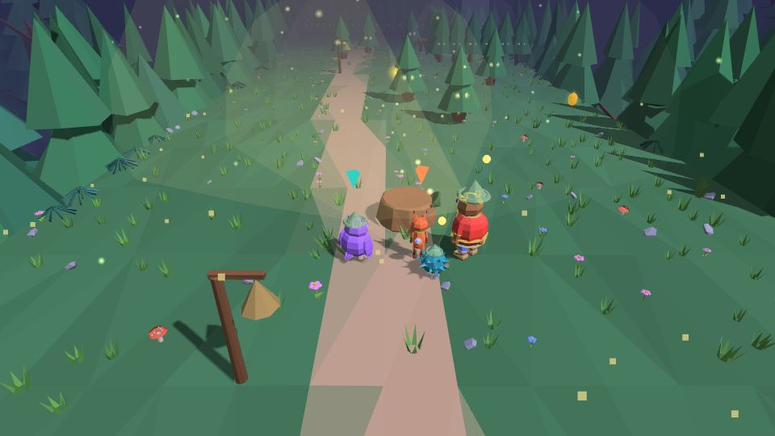
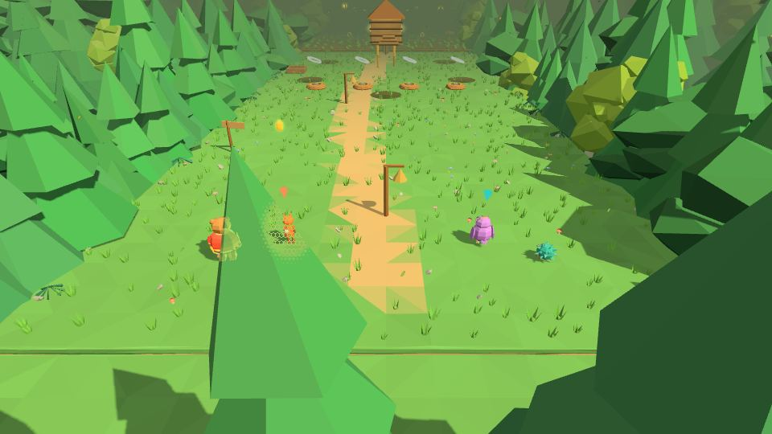
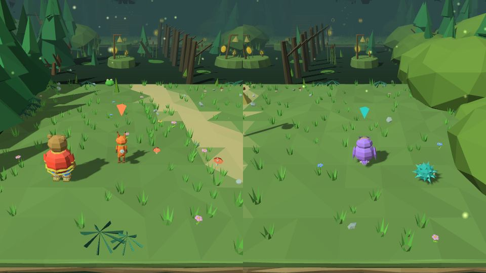
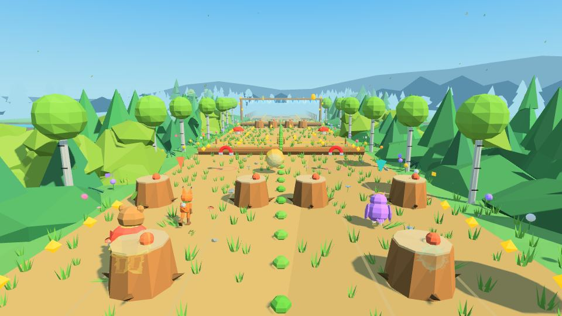
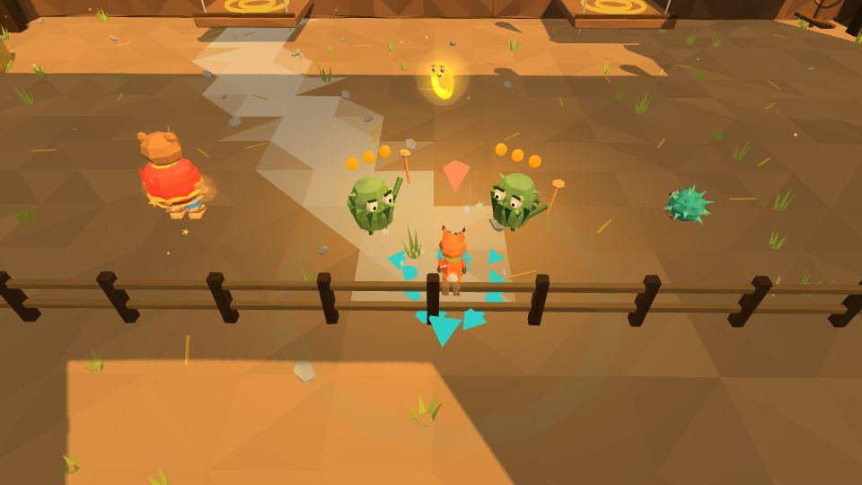

# Мир 1 · Дремучий лес

| 🌲 **Дремучий лес** | |
|---|---|
| **Чудо-вещь** | 🧶 [клубок-путеводитель](Чудо-вещи#-клубок-путеводитель) |
| **Уровни** | 1-1 · 1-2 · 1-3 🎵 · 1-4 · 1-5 · 1-Б 👑 |
| **Звенья** | 20 (ворота к боссу — 12 скованных) |
| **Босс** | Леший-Путаник |
| **Особый морок** | Тать-Паутинник (1-2) |
| **Цвет вышивки** | зелёный |

Ремарки в роликах мира (курсивные строки без имени) читает вслух Сказительница.

Лес, где ёлки ходят, пока на них не смотрят, а в избушке на курьих ножках живёт Баба Яга. Звенышко ведёт героев и подсказывает.

---

## Версия мира 1 для детей 7–11 лет
Пролог и уровни 1-1 … 1-Б мягче, чем остальные миры (подробности — `zlataya_cep/docs/27_kids_world1.md`):
- **Лёгкий путь** в этом мире: вспышка до удара 0,9 с (в остальных мирах 0,7), окно отбива 0,40 (0,35), Пробой 9 с (6), красный знак — кувырок — идёт в 1,5 раза дольше, а кувырок за 0,8 с до удара засчитывается. На **Среднем** — Пробой 5 с и красный знак на 20 % дольше.
- **Подсказки и баннеры** остаются на экране в 2,5 раза дольше; **помощь по задаче** приходит быстрее (ореол цели — через 10 секунд на Лёгком, 13 на Среднем, а не через 20; призрачный показ — через 20 / 27, а не через 40).
- **Задачи читаются вслух** записанным голосом (Байя; около 770 записей, включая уроки боссов, русский голос в системе не нужен; голоса браузера в игре нет, текст без записи не читается): каждая — один раз; **H** или **LB** — «Повтори»; выключается в меню паузы. В мирах 2–5 чтение вслух включается пунктом «Читать во всех мирах» (авто — если кто-то идёт Ёжиком или Лисёнком).
- В мирах 2–3 эти настройки сходят плавно — см. [[Бой]]; в мирах 4–5 их нет.
- Над **активным героем** — стрелка цвета игрока.
- Упавший игрок видит подсказку «Ты отдыхаешь — не страшно!».
- **1-3 «Колобок»**: окно попадания в долю ±0,20 с на Лёгком и ±0,12 с на Среднем (было ±0,15 и ±0,10); богатырский — как был.

### Сохранение по частям
Три самых длинных уровня мира сохраняются по частям — на границе части всплывает карточка, а при новом входе в уровень Игрок первый выбирает «Продолжить с: Часть …» или «Начать сначала». Звенья и орешки, собранные до этой точки, остаются засчитанными; пройденный уровень стирает запись.

| Уровень | Части |
|---|---|
| 1-1 «Избушка, повернись» | II · За калиткой (вороны Кощея, стог, ступа Яги, теремок) |
| 1-2 «Кикиморино болото» | II · Туман (огоньки-обманщики, Царевна-лягушка, бесёнок у омута) |
| 1-5 «Кикиморина прялка» | II · Овин · III · Сушильня · бой с Веретенником (без карточки) |

### Свет и музыка уровней
У каждого уровня мира свой цвет и своя версия музыкальной темы (мотив один на весь мир — ля дорийский, узнаётся сразу):

| Уровень | Свет | Музыка |
|---|---|---|
| 1-1 «Избушка» | тёплый жёлто-зелёный день во дворе Яги | балалайка бойче, бубен на каждую долю |
| 1-2 «Болото» | бирюзовая сырая дымка, видно ближе | бурдон, медленная жалейка, глухой барабан |
| 1-3 «Колобок» | свой свет по частям песни | своя песня по партитуре |
| 1-4 «Леший водит» | сине-фиолетовые сумерки, светлячки над тропой | тихо: колокольчики и бурдон, без барабанов |
| 1-5 «Прялка» | янтарный свет подворья | остинато по три ноты — крутится прялка |
| 1-Б «Леший-Путаник» | ночь → рассвет по этапам | темы этапов боя |

**Музыкальные вставки** — короткий мотив поверх темы (тема на 2,5 с стихает): прилёт ворон Кощея (1-1), туман Кикиморы (1-2), знакомство с Аукой (1-4), Веретенник (1-5).

За спиной героев на старте 1-1 поляна продолжается ельником, а камера 1-5 не уходит за заднюю стену сеней — края «плиты» мира не видно.

---

## 1-1 «Избушка, повернись»

**Звенья:** 5 · **Новое:** пеньки, кикиморки, клубок, вороны Кощея · уровень вдвое длиннее (≈250 м)

- **Пеньки «на раз-два-три»** — прыгают вместе.
- **Кикиморки** — жёлтый сигнал и отбив (см. [[Бой]]).
- **Уборка двора**: кикиморки намусорили — девять вещей несут в одну кучу (рыбьи кости, огрызок, битый горшок, дырявое ведро, тряпка, лапоть, сломанная ложка, гнилая капуста — каждая лежит на грязном пятне, над ней вьются мухи и тянется зелёный дымок; подобранное остаётся лежать в куче); **корыто** поднимают только вдвоём. За чистый двор Яга дарит каждому **клубок-путеводитель**.
- **Нить-тропка** через засаженные грядки (пешком не пройти — вязкая земля выталкивает обратно), подкидка Потапа.
- **Болото за сараем** — нить к нити, как в 1-2: чёрная трясина, рогоз, кувшинки, коряги, пузыри и лягушки (квакают, плюхаются в воду, если подойти). **Болотное чудо** пускает пузыри и светлую кромку, потом вылезает и сталкивает с нити — отойди или закройся щитом; упавший — назад к колокольчику.
- **Финал — калитка-упрямица**: четыре плиты, две снаружи и две внутри; калитка открыта, пока нажаты обе наружные или обе внутренние. Сошли с лапок — калитка закрывается. Двое держат наружные лапки, двое других проходят и встают на внутренние — тогда проходят оставшиеся («оставленный держит»: героя на лапке можно сменить, он так и стоит). У калитки, пока оба героя здесь, **экран не делится** — обе лапки и калитка в одном кадре.
- **За калиткой — вороны Кощея** (ролик: «Карр! Кощей велел: клубочки отнять!»). Три ворона кружат над героями; один пикирует: сначала по земле за героем ползёт тень, потом **красный круг** встаёт на место и наливается — **беги из круга**, пока не налился (на Лёгком пути круг стоит дольше). Щит от ворона не спасает. Схватил — назад к колокольчику.
- **Стог сена**: ударь по стогу — сено ложится **шалашом**, орешек падает со стожара; в шалаше ворон не углядит. Это двухскатный шалаш из слоёв сена с жердями над входом (вход — к тропе, спина и бока глухие). Ещё четыре таких шалаша стоят готовыми вдоль тропы — перед рощей, в роще и после ручья: заходи внутрь, пока красный круг ползёт.
- **Ступа Яги** застряла в коряге у вороньей рощи (сухие берёзы с гнёздами): поднять её может только **Потап** (кнопка умения у ступы). Ступа взлетает и метёт помелом пыль над рощей — в пыли вороны не видят. Без пыли в роще пикируют без передышки. («Помогли старухе — старуха добро не забудет».)
- **Лесной ручей, топкие берега**: ноги вязнут, ручей переходят **по нити**; над ручьём лопухи — под ними ворон не видит.
- **Теремок**: медведь сел — верх раскатился (Прошка: «Потап, это не ты?»). Три бревна к срубу — три венца: бревно **Потап несёт один**, другие герои — только **вдвоём**; **конёк с петушком** лежит на лесах — туда **подкидкой Потапа** или **Пелагеей**: по лесенке из чурбаков наверх, прыгнуть к лесам и держать прыжок — долетит, планируя (другим героям с чурбаков не достать); там же пятое звено. Петушок на коньке кукарекает — вороны улетают к Кощею ни с чем.
- Финал — **новоселье**: Потап не пролезает в дверь, звери (мышка-норушка, лягушка-квакушка, зайчик-побегайчик, лисичка-сестричка, волчок) смеются, все в хоровод.
- Ролик «Яга ставит задачу»: дверь избы со скрипом отворяется, в темноте блестят очки — выглядывает сердитая Яга; грозит пальцем, показывает золотой клубок-награду; Прошка хорохорится («сам верёвку сплету!»), Яга молча глядит поверх очков; лужа за спинами вскипает — кикиморки.
- Ролик «Клубки в дар» (после уборки): герои сбегаются к крыльцу, Яга бросает клубки, а потом вприскочку обходит героев и каждому шепчет на ухо про шапку наизнанку; Прошке — последнему и тем же взглядом поверх очков: клубок выскальзывает, нить обматывает Прошку, а клубок катится через грядку и тянет золотую нить — так и ходят по грядкам.
 

## 1-2 «Кикиморино болото»

**Звенья:** 4 · **Новое:** струны на колышках, кувырок, Тать-Паутинник · самый длинный уровень мира (360 м)

- **Струна на колышке** висит, пока её не смотаешь; с высокой ветки по струне съезжают, повиснув.
- **Толстую струну** держит только [[Потап]]: тонкая нить тонет в трясине в 3,5 м от берега, а в тумане Пелагее не спланировать.
- **Кувырок** — новый приём.
- **Тать-Паутинник** грызёт пустую струну: встань на неё — отступит. На Лёгком пути у Паутинника только жёлтый знак (щит) и два уголька вместо трёх.
- **«Журавль и Цапля»**: гать из четырёх струн между избушками; на кочках — три Паутинника.
- **Огоньки-обманщики** в тумане: рогатка по огоньку — ложный лопается «Хи-хи!», настоящий поднимает тропу. Нить над туманом тонет («Буль!»): перебросить её через трясину нельзя, только тропа из кочек. Подсказка второго игрока по ходу: «жди», пока Прошка щёлкает огонёк; тропа открыта — «прыгай по кочкам»; неполитая засохшая кочка — «полей» (она на второй и четвёртой тропе). Засохшую кочку видно издалека: она тёмная, со сухими стеблями, над ней парит голубая капля; с островка перед тропой Пелагее светится «К · Йоша польёт», Йоше — «на первую кочку!», а с первой кочки — «полей!». С острова до кочки 7,4 м — не допрыгнуть и не долить, поэтому Йоша сперва прыгает на первую кочку (до засохшей от неё 4,3 м). После полива капля и стебли исчезают. Огоньками **дирижирует Кикимора**: она стоит на кочке у края тумана, за пеленой, с золотым ключом на поясе (тем самым, что в 1-5 заставит её прясть); все тропки открыты — уходит в трясину.
- **«Царевна-лягушка»**: Прошка сбивает стрелу Ивана-царевича — кувшинки всплывают в лад «Ква!»; завядшую оживляет Йоша. На большой кувшинке Лягушки — свой колокольчик: упал в пруд после него — вернёшься на кувшинку, а не на берег.
- **Бесёнок Балды** зовёт наперегонки вокруг омута — бегом не обогнать, но можно хитростью: струна через омут или «братишка» у флажка. Обогнали — бесёнок сам откатывает колоду с дороги и платит оброк орешками.
- **Открытки**: на входе в каждую сказку (Журавль и Цапля, туман с огоньками, Царевна-лягушка, бесёнок у омута) камера на 3,6 с показывает её сверху. Это не ролик: игра идёт, кнопки работают.
- **Живое болото**: чудо болотное у гати выталкивает со струны (щит держит), лягушки, камыш, кувшинки.
 

## 1-3 «Колобок» 🎵

**Звенья:** 3 · **Тип:** гусельный раннер в пяти частях

У каждого игрока три дорожки, тропинка бежит сама. «Лад» подряд — искры ×2 и ×3. **Лепестки:** каждое спотыкание (не перепрыгнул препятствие, зверь толкнул) снимает лепесток; кончились — герой 8 долей отдыхает (катится за Колобком, искры не собирает), потом снова все три; каждое попадание напарника сокращает отдых на две доли («Друг выручает!»). Поражения нет.

- **Струна-гусли** — деревянная дека поперёк дорожки, три серебряно-голубые струны, над ними стрелки «вверх». Кружок на деке сжимается к доле и белеет в долю: прыжок в этот миг подкидывает высоко («В такт!», в полдоли окна — «Чисто!», за попадание — искры), струна звенит нотой песни. Мимо доли («рано» / «поздно») струна всё равно подкидывает так же высоко, но без искр и с потерей «Лада». На Лёгком пути окно струны шире в полтора раза.
- **Колобок показывает:** он катится ровно на две доли впереди и подскакивает на каждой струне — через две доли черёд игрока.
- **Полёт со смыслом:** по дуге полёта висят голубые искры-ноты (по 2 искры, берутся только в высоком прыжке); **плетень** (опушка) и **бурелом** (лисья тропа) простым прыжком не взять — только со струны (хоть и не в долю), иначе герой перевалится через них и потеряет лепесток; **воздушные струны** висят на шестах на высоте полёта — со струны на струну; обвал моста — тоже только со струны: у обвала (доли 50 и 61) и над водой (62) струны поперёк всех трёх дорожек.
- **Двойная струна** (радуга над межой, доли 30 и 95): оба игрока попали в одну долю — «Двойной звон!», обоим выше и +5 искр.
- **Встречные из сказки** — Заяц (опушка), Волк (речка), Медведь (лисья тропа): «Колобок, Колобок, я тебя съем!» — Колобок отвечает песенкой, зверь четыре доли пропевает её (скачет и звенит в свои доли, бусины над ним вспыхивают), следующие четыре доли игрок повторяет щитом в те же доли. Все доли — зверь пляшет (+3 искры), часть — «почти», ни одной — толкнёт.
- **Лиса**: каждое попадание на лисьей тропе отгоняет её; в конце «сядь мне на носок!» — три попадания по финальным струнам (и воздушным) — лиса запутывается в струнах (+5). Кого не отпустила — та сама спотыкается о корень.
- **«В лад»**: прыжок на «и» (за полдоли до коряги, бочки, дыры) — герой над препятствием ровно в долю, +1 искра.
- **Музыка растёт с «Ладом»**: ×2 — вступают балалайка и бубен, ×3 — подголоски; сорвался большой лад — слой на долю выпадает. Линии дорожек и флажки арок вздрагивают в долю.
- **Звёзды части** (★ — добежал, ★★ — 70 % попаданий, ★★★ — 90 %) — над героем на границе части и в итоге уровня; рекорд искр хранится на этом устройстве.
- Звено части не взято и струн меньше половины — повторяется только последняя фраза (с зова зверя), не вся часть.

| Часть | Темп | Что там |
|---|---|---|
| Солнечная опушка | 96 | струны, плетень, коряги, подкова-магнит, гриб-прыгун, Заяц, двойная струна со звеном |
| Через речку | 104 | дыры в мосту, бочки, перо — гусь несёт над обвалом, Волк, обвал со струны и воздушная струна над водой |
| Лисья тропа | 112 | лиса сзади: три спотыкания — стащит пять искр; Медведь, бурелом; в конце струны и воздушные струны — запутай лису |
| Волчья чаща | 116 | 48 долей: первые 16 — урок (волк, медведь, кабан — по одному, Звенышко называет каждого), дальше бой на бегу: волк (уйти), медведь (щит в такт), кабан (прыжок), вожак — щит вдвоём |
| Гуси-лебеди | 120 | 48 долей: первые 16 — урок (ворона, коршун, туча — по одной), дальше полёт над долиной: ворона, коршун, гроза, вожак — вдвоём |

**Вожак** (чаща — волк, гуси — тёмный гусь с золотым венцом) летит навстречу посередине между игроками; за три доли вокруг него загорается жёлтое сияние, над ним счёт «Три… Два… Раз… ЩИТ — вдвоём!», у каждого героя сжимается жёлтый круг. На «ЩИТ» сияние и круги белеют — оба жмут щит в эту долю.

**Значки на дорожке** (части 4–5): за 1,3–3 доли до встречи над зверем, птицей или тучей — его кнопка и два слова («вбок», «щит в такт», «прыгай», «облети», «щит вдвоём»); на Лёгком пути — всегда, на Среднем — первые три встречи каждого вида, на Богатырском — нет. Карточка задачи в этих частях — одна строка.

**Финал** — пляска на гуслях в три стадии: «раз-два», «перекличка», «хоровод». Не взял звено части и промахнулся — часть повторяется.

**Ролики** поставлены вручную (`levels/1-3/late_99zy_k13_kino.js`): вступление (Колобок крупно поёт «Я от бабушки ушёл», подмигивает и — к тропе), «Ну, ешь» (герои приземляются вокруг Колобка, он жмурится и дрожит; Прошка «не по сказке» отказывается — глаза распахиваются по одному, прыжок от радости; Пелагея рисует в воздухе нового Колобка золотыми точками, Прошка подглядывает) и финальная пляска — с крупным планом Колобка на его сказ.
 

## 1-4 «Леший водит»

**Звенья:** 4 · **Орешки:** 7 · **Новое:** ходячие ёлки, Совиный взор, «Ау!», Аука-Перекличка (мирная игра)

- **Ёлки ходят, пока на них никто не смотрит**; луч светлячка есть и у оставленного героя.
- **Ролики** поставлены вручную (`levels/1-4/late_99zx_k14_kino.js`): «Шапки из мха» (трое надевают шапки, Прошка бросает свою на пень — «деревья не ходят», а за его спиной крадётся ёлка), «Пелагею увели» (ёлки хороводом уносят её в кольцо, Леший хохочет из-за леса, Йоша корит Прошку, шапка ему на нос; из кольца Пелагея держит тропу взглядом), знакомство и дружба с Аукой.
- Йоша поливает ель-замок, Прошка сбивает три замка-шишки — каждую со своего следа.
- Ель привязывается клубком у колышка. На своей поляне Леший стоит на опушке и водит ёлки («Водит вас мой лес — по кругу да по кругу!»): **Совиный взор** показывает серебряную тропу; нить по серебру — ёлки замирают, Леший обижается («Так нечестно!») и уходит в чащу. Прятки с Лешим — только в бою 1-Б.
- **«Друг за друга»**: две тропки за низкой изгородью. Ёлки своей тропки твой взгляд не держит — только взгляд с другой тропки: один стоит у изгороди и смотрит на тропку друга, другой бежит, потом меняются. В одиночку — оставь героя лицом к другой тропке.
- **«Хоровод ёлок»**: три кольца ёлок кружат вокруг пня со звеном. Ёлки держатся за руки лентами — между ними не пролезть никому, даже Йоше; вход — только **золотые воротца**. Глянешь на кольцо — оно замирает (ленты в инее), дальние кольца за ним кружат. Пройди в воротца замершего кольца — оно встанет насовсем (ленты золотые); дошёл до пня — хоровод кланяется и открывает выход.
- **«Леший водит по кругу»**: поляна-петля. Встань на пень-эхо и аукни (кнопка «Ко мне!» здесь — **«Ау!»**): настоящий выход откликается золотым огоньком — беги туда, пока горит. Ложный проход возвращает к пню. Три поляны подряд — и круг разорван; со второй поляны по тропе ходят ёлки, а пустые проходы отвечают серым эхом. В одиночку оставленный на пне герой аукает сам.
- **Аука-Перекличка** — пузатый лесной дух в шапке-мухоморе; боя нет, это мирная игра «повтори за мной». Аука сидит на пне посреди поляны и поёт «ау» дуплами: у каждого из четырёх дупел свой голос, цвет и знак над ним (лист, капля, цветок, звезда). Сначала слушай — потом встань в цветной круг у дупла и аукни (**«Ау!»**) в том же порядке. Ошибся — Аука хихикает и поёт снова, без наказания; после двух ошибок подряд следующее дупло подсказывается. Три песенки: на Лёгком пути 2 → 3 → 4 «ау», на Среднем 3 → 4 → 5, на Богатырском 3 → 5 → 6. Вдвоём аукают оба, в одиночку — сам. Спели — «Ой… ответили!», подружились, Аука ведёт к выходу.
 

## 1-5 «Кикиморина прялка»

**Звенья:** 4 · **Новое:** паутинка, мотовило и мешок-гиря, ткацкий стан на две подножки, сторожевые нити · **Мини-босс:** Веретенник

**Сюжет.** Кикимору заворожила **чёрная нить-ключник**: она тянется со двора через все залы под крышей к её веретену (потом — за веретеном на повить), и Кикимора прядёт во сне. Нить ведёт героев; когда Веретенник рассыпается, она лопается и уползает с ключиком в щель.

**Ролики** поставлены вручную (`levels/1-5/late_99zw_k15_kino.js`): вступление (Кикимора во сне, чёрная нить в веретене, герои в сенях и показка мотовила — контур Потапа опускается, Пелагея поднимается на полати), веретено удирает, Веретенник просыпается (сверху — план боя: струны крест-накрест), этап 2 (Кикимора из овина: «троиться станет»), финал. **Показки** — короткие ролики при входе в зал: ткацкий стан (подножка поднимает нити, клубок — полоса, потом другая подножка) и паутинка (две золотые струны крест-накрест, сплетается сетка, контур подлетает на галерею).

Подворье Кикиморы из пяти просторных залов (30 м в ширину, овин — 26 м), путь около 125 м. **Звенышко ведёт**: висит над следующей целью — площадкой мотовила, подножкой, кольцами, дверью, плитами засова, кругом-приманкой. Зал решён — над выходом из него горит золотая стрелка; при входе в ткацкую и сушильню — название зала.
- **Сени-мотальня.** Кикиморки-прядильщицы и **мотовило-противовес**: две площадки на одной нити. Стоят на обеих — кто тяжелей, тот вниз, другой — вверх, на полати (Потап весит за двоих). На площадках — контуры (слева Потап, справа друг), над ними **весы**: гирьки — вес стоящего, стрелка — куда поедет. **Поровну** — площадки покачиваются, и каждые 7 с подсказка: смени героя на Потапа или ударь **мешок шерсти** — он прыгнет на площадку, куда смотришь, и добавит вес (ещё удар — обратно на пол). Вес считают только те, кто стоит сам: **ведомые** (второй герой напарника-бота, «Все ко мне» в одиночку) не в счёт — раньше Йоша шёл за ботом на ту же площадку, и выходило «поровну». Прыжок на площадке вес не снимает. Поднявшаяся площадка **защёлкивается** («щёлк»), пока с неё не сойдут; в перилах полатей напротив площадок — калитки. Наверху клубок на мотовило — нить наматывается и поднимает оставшегося. Пока решают мотовило, экран общий и в кадре обе площадки; скрипит канат (чем тяжелее — тем ниже).
- **Ткацкая.** Через провал ткут мост: один стоит на **подножке** (зев открыт), второй бросает клубок-челнок в зев — пять полос, и полотно-мост готово. Подножек **две** (красная и синяя) — как у настоящего стана, по очереди: светится та, что нужна; на другой зев закрыт. Со второй полосы мешает кикиморка («Не тки!»). Экран у стана общий. В углу — куча кудели, в ней что-то поблёскивает: ударь — **тайничок Кикиморы** с орешком.
- **Овин.** **Паутинка** из двух струн крест-накрест: в кольцах стоят контуры — кто куда встаёт, точки показывают бросок, дуга — прыжок; паутинка сама несёт на следующий этаж. **Прялка** утягивает струны — жёлудь в веретено или старая нить через Совиный взор. Кикимора следит за героями головой и раз в ~13 с швыряет клок кудели: куда упадёт (видно по кругу на полу) — 5 с липко, медленно. Паутинка — настоящая сетка из спиц и колец, на прыжке прогибается. На чердаке веретено вырывается у Кикиморы и улетает на повить.
- **Сушильня.** **Сторожевые нити** видны только Совиным взором (вблизи чуть мерцают): низкую — перепрыгнуть, высокую — обойти в просвет (Йоша пролезает под ней). Задел — «дзынь», с потолка падает нитяной морок. Над нитями качается бельё: где полотнище чиркнет нить, та на миг блеснёт. Задела высокую нить Пелагея — подсказка, что Йоша пролезет понизу. Дверь открывает засов на двоих: обе плиты разом (ворота уходят в пол). Пока оба героя в сушильне, **экран общий** — обе плиты засова и дверь в кадре. Стена на повить — перегородка до половины высоты: поверх видно гнездо Веретенника.
- **Повить — мини-босс Веретенник** (два этапа). Зал 30 × 28 м без столбов посередине, всё на одной линии: **гнездо** Веретенника у задней стены → **паутинка** посередине → **золотой круг-приманка** у входа. Кокон из чёрной кудели не пробить. Шаг 1: каждый встаёт в своё кольцо у входа (там нарисован герой) и бросает клубок в колышек напротив — струны скрещиваются посередине. Шаг 2: паутинка готова — загорается круг и дорожка от гнезда; кто встал в круг, на того Веретенник бросается из гнезда и влетает в паутинку. Шаг 3: кокон слетел — бить острие (≤ 3 удара за окно, с паутинки сверху — вдвое). Шаги видны на полосе босса (текущий — золотом), задача в карточке — одна строка на шаг. Паутинка после поимки цела; рвёт струны только **белая нить** — она метёт вокруг гнезда (прыжок), если долго никто не встаёт в круг. Рывок не в паутинку — красная дорожка: кувырок в сторону, а Прошка рогаткой в острие сбивает разгон. Ударился о стену или колышек — «Бух!», и шагом обратно в гнездо: в углу и за столбом он больше не застревает. После рывка остаётся липкая кудель — по ней медленно. Этап 2: нитяные мороки и **три веретена** — настоящее в золотом кольце видно Совиным взором.
- Камера: в каждом зале не отъезжает назад за его заднюю стену (не смотрит сквозь стену прошлого зала), висящая кудель — у стен, не на пути камеры; стены подворья не пускают камеру наружу при вращении. В бою с Веретенником — своя камера сверху, под ~60°: в кадре гнездо, паутинка, круг и оба героя.
 

## 1-Б «Леший-Путаник» 👑

Руки-коряги, прятки двойников «Ищи-свищи» и «Хоровод» со скакалкой (прыжок — белая полоса под лианой) и Богатырским махом. Подробно — **[Боссы](Боссы#-леший-путаник)**.

**После босса**: праздник и **Сказ 1** (Игрок 2 выбирает начало, Игрок 1 — помощника, конец — вдвоём), Кузьма вешает на дуб первую цепь, ролик **«Голос»** 🔒.
 

---
← [[Пролог]] · [[Миры]] · [[Мир 2 · Подводный Китеж|Мир-2-Подводный-Китеж]] →
