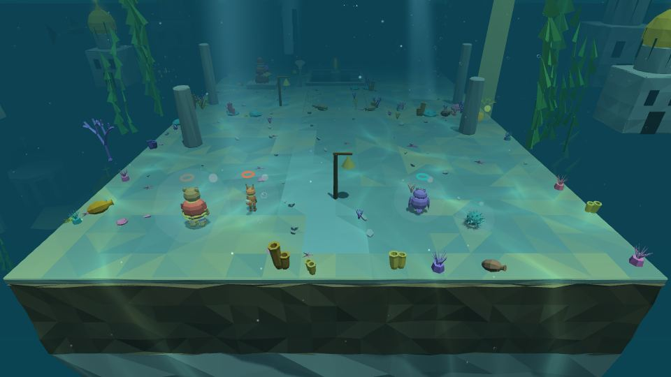
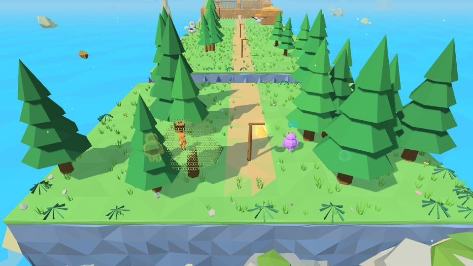
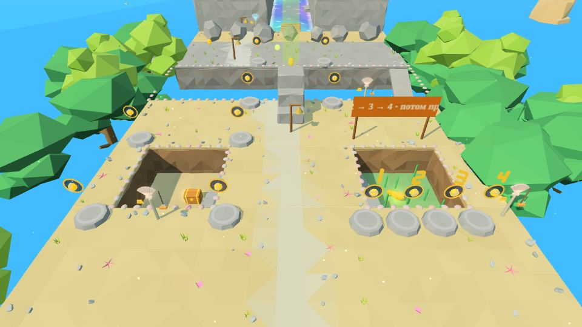
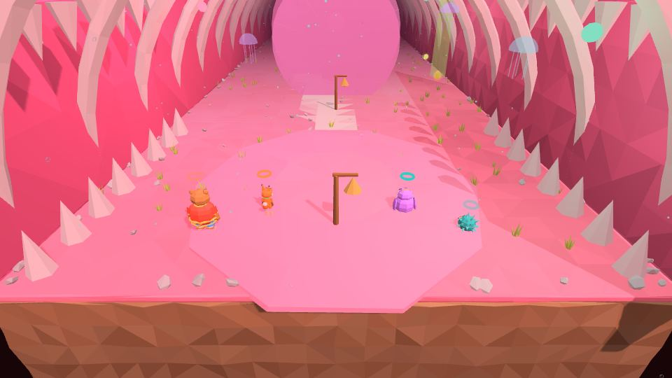
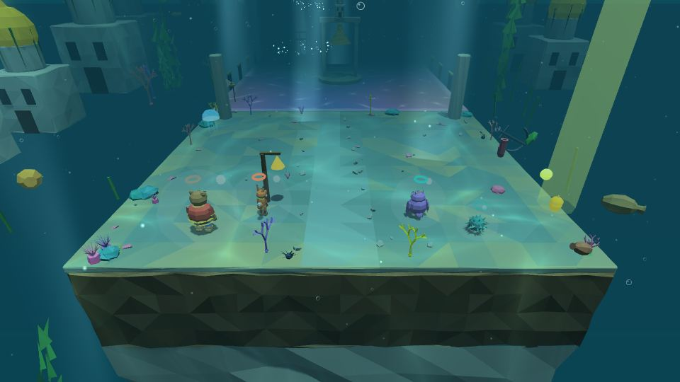

# Мир 2 · Подводный Китеж

| 🌊 **Подводный Китеж** | |
|---|---|
| **Чудо-вещь** | 🎼 [гусли Садко](Чудо-вещи#-гусли-садко) — прилив ↔ отлив |
| **Уровни** | 2-1 · 2-2 · 2-3 👥 · 2-4 · 2-5 · 2-Б 👑 |
| **Звенья** | 20 |
| **Босс** | Водяной |
| **Особый морок** | Тягун (2-5) |
| **Весточка помощника** | из Сказа 1: светлячок Лешего, ступа Яги или пружинка Колобка |
| **Цвет вышивки** | синий |

В этом мире Ёжик и Лисёнок играют по смягчённым окнам (замах 0,82 с, отбив 0,38, Пробой 8 с; подсказки в 2,2 раза дольше) — см. [[Бой]]; у длинных задач над полным текстом есть крупная короткая строка (≤ 12 слов), её же читает голос.

Ремарки в роликах мира (курсивные строки без имени) читает вслух Сказительница.

Город на дне озера, который «забыл звонить». Перед первым походом Пелагея читает по тетрадке, шёпотом: «Кот говорил: под водой есть город…». Во всём Китеже стены между камерой и героем становятся прозрачными.

**Во всём мире:** у каждой воды гуслей стоит **мерная рейка** (синяя метка — прилив, жёлтая — отлив, поплавок на глади; рейка воды, которую сейчас поменяют гусли героя, мигает золотом). У каждого уровня своя музыка — город (2-1), дыхание кита (2-2), вечернее озеро (2-3), сердце (2-4), колокола (2-5), — и во всех раз в несколько кругов звучит **напев Садко**. В длинных 2-1 и 2-2 звон колокольчика запоминает участок: вышел и вошёл снова — «Продолжить с колокольчика?» (прыжок — продолжить, звенья и орешки при вас; щит — сначала).

---

## 2-1 «Гусли Садко»

**Звенья:** 4 · **Новое:** гусли, прилив и отлив, щуки, спящий Китеж

- Идём по дну в пузырях воздуха. Йоша сращивает мёртвой водой струну Садко — и Садко дарит **гусли** («Только в Китеже не молчите»).
- Звено на столбе фонтана достают приливом. Ролик «Пустая книга»: переплёт без страниц, на корешке «Не про меня».
- У каждого своя сторона улицы: в прилив лодки всплывают до крыш, в отлив открываются подвалы с орешками; в доме-колодце вода работает как **лифт**.
- У каждой воды стоит **мерная рейка**: синяя метка — прилив, жёлтая — отлив, поплавок держится на глади. Рейка воды, которую сейчас поменяют гусли героя, мигает золотом.
- **Щуки-мороки** пускают синие пузыри — отбил пузырь, и щука «сама себя». В правом канале Переливной улицы щука охотится на любого героя, что зашёл в её воду, — в одиночной игре тоже.
- Порядок участков — от простого к парному. Сначала **шлюзы**: две ступени воды, каждую поднимаешь приливом сам, сверху лестница вниз. Потом **Переливная улица**: вода в двух каналах одна, Потап держит заслонку на дне, прилив у одного — отлив у другого.
- Дальше: **торговые ряды** (Жемчужница в пруду — отлив), **Звонкая мостовая** (две плиты по очереди: «дзинь», потом «дилинь»; «дон-дон» допевают ворота), палаты Морского царя, **две раковины** (левой — прилив, правой — отлив, одновременно), сад Китежа и **Рак-Отшельник**.
- На Среднем пути у героя не больше двух щук-стрелков сразу (как на Лёгком).
- Задачи — 13 коротких карточек, одна карточка — одно действие; Переливная улица — две карточки (заслонка, потом лодка и верёвка).
- После подарка гуслей Пелагея шёпотом спрашивает: «А если голос… тихий?» — Садко: «И тихий голос вода слышит». Это начало её дуги до 2-5.
- Край улицы — риф из камней и кораллов, вдали — большие силуэты храмов Китежа. В тёмной воде за рифом иногда светятся жёлтые глаза **Водяного**: подойдёшь — нырнёт (он появится в 2-Б).
- **Оставленный держит.** Сменил героя — прежний остаётся и делает своё: Потап держит заслонку, гусляр доигрывает напев 15 секунд. Над доигрывающим — круг-таймер с секундами. В палатах царя это показывают в ролике: призрак играет первый голос, герой сменён — оставленный играет сам, второй идёт ко второму стулу.
- **Ворота Китежа.** Рак срезал водоросли — а за аркой **спит Китеж-град**: ни звона, ни огонька (ролик «Китеж спит»). Уровень продолжается в городе.
- **Спящая слобода.** На лавках у дверей спят горожане, над ними «з-з-з». У каждого — ракушка: сыграл гусли — проснулся, окно загорелось, нотка напева Садко летит к **Сонным воротам**. **Дед и бабка** через улицу просыпаются только разом: сыграйте оба, а в одиночку — сыграй у одного и смени героя (оставленный доигрывает). Четыре нотки — ворота поднимаются.
- **Главная звонница.** Колодец перед ней — прилив поднимает на площадку. Там последнее звено и **колокол без языка**. Пелагея шепчет «Бом…» — тишина.
- **Ролики «Колокол без языка» и «К киту»** (финал уровня): на осетре приплывает Садко — «Колокол без языка — вот Китеж и спит. **Водяной язык сорвал — а Рыба-кит проглотил**». Высоко над городом плывёт тень кита. Герои садятся на осетра — и он везёт их к киту (2-2). Так 2-1 задаёт цель всего мира: достать язык (2-4) и разбудить Китеж (2-5).
  - Бой с Раком — два этапа, сверху полоса «Рак-Отшельник · этап N / 2»: 1) сыграть на гуслях у ракушки-музыкалки, рак заслушается — Потап вытягивает его из раковины; 2) рак без домика удирает: зажать с двух сторон, песок отбивать щитом, зарывшегося находит Совиный взор Пелагеи. Подсказки короткие («Рак пляшет — бей F!»).
 

## 2-2 «Чудо-юдо Рыба-кит»

**Звенья:** 4 · **Новое:** перелив через заслонку на хребте кита

- Вступительный ролик показывает всё как у Ершова: кит лежит поперёк моря, на хвосте сыр-бор, на спине село, на губе пашут, между глаз пляшут, в усах — дубрава. У кита поднят хвост с плавником, спящее лицо с румянцем и улыбкой, дыхало; вокруг него пена, в боках — колья. Когда кит открывает глаз, открываются и глаза на лице. Стихи Ершова в ролике читает вслух Сказительница.
- Осётр Садко привёз героев из 2-1: где-то в ките — язык колокола Китежа, Йоша сразу об этом вспоминает.
- Потап забыл былину; деревня на спине кита.
- Вода на ките обычная: гусли меняют воду там, где стоишь.
- Двор → огород и мачта → фонтан: в прилив подбрасывает до облаков.
- **Огород — перелив**, как на Переливной улице 2-1: две заводи по сторонам частокола, Потап держит заслонку. Слева сперва отлив, справа прилив — один перелив, и Игроку 1 прилив к мачте, Игроку 2 отлив к лазу. Обратный перелив — бонус: кувшин на дне слева и орешек из бочки справа.
- Кит делится на три части: хвост и село → бока и губа → голова. На стыках — **смотровые горки** с колокольчиком и именем следующей части; внутри частей ещё колокольчики (после рёбер, перед дубравой и после неё).
- Снос на выдохе на Лёгком пути вдвое слабее, а на рёбрах его нет.
- Хоровод между глаз и дубрава — одна задача: 4 камушка у каждого и 4 боровика; счётчики — кружками.
- Из моря по бокам кита торчат луковки куполов Китежа. Когда спета первая строка колыбельной, Пелагея тихо подпевает свой куплет.
- Раки-щипачи вязнут в грядках; чайки и прилипалы.
- **Трещина в хвостовом плавнике**: Потап валит сосну.
- **Колыбельная киту** в три куплета: в лад с волной от дыхала, сонные звёздочки Совиным взором, четыре голоса разом.
 

## 2-3 «Невод» 👥

**Звенья:** 3 · **Тип:** на четверых

- Вечернее озеро на закате; вдали — силуэты храмов Китежа, в тёмной воде иногда светятся глаза Водяного.
- У камня со знаком клубка RB берёт клубок; четыре нити Йоша сращивает мёртвой водой — получается **невод**. Угол держит тот, кто стоит на камне (оставленный тоже); меньше трёх углов — невод провисает. Над камнями — **схема**: значок героя, кому где встать; камни текущей задачи подсвечены столбом света.
- Три задачи: сундук со дна; невод-мост над течением; **золотая рыбка** — четыре кольца в ряд «1 → 2 → 3 → 4 · потом прилив»; кольца обходит один герой. После суда Пелагея шёпотом спрашивает рыбку, можно ли, чтобы её слышали.
- После рыбьего суда **Ёрш** ведёт к Рыбе-киту: лодка по течению, заросли рубят с лодки, в протоке плюются пузырями две щуки Водяного, на отмели четыре уса щекочут разом (верхние — рогаткой). Кит зевает — «Глоть!» — и сразу 2-4.
 

## 2-4 «В брюхе у кита»

**Звенья:** 5 · **Новое:** общий экран, пульс сердца

- Внутри тепло и светло: рёбра, светящийся планктон, медузы — всё пульсирует под стук сердца.
- **Глотка** → **перепонки** (раскрываются в такт сердцу) → **желудочное озеро** с кораблём: Йоша поливает клапан, Прошка сбивает колокол — Йоша впервые просит: «Прошка! Позвони в колокол! Пожалуйста!»
- Язык колокола со дна Потап несёт над головой до сердца — «Донёс!». В заливе один корабль китежский, с луковкой; в тёмной воде — глаза Водяного.
- **Кислые лужи** сжимаются на каждый удар сердца — проходить в такт; тинники и пузырники → **сердце** (счёт сердечками ♥/♡): клапаны-батуты, пузырь ловит Пелагею.
- Три **реснички** бьют вдвоём одновременно — кит чихает, и всех выносит на берег. «Я не сам. Я попросил.»
 

## 2-5 «Китеж звонит»

**Звенья:** 4 · **Новое:** колокола, Тягун, ладья-призрак

- Каждый колокол звонит, только когда вода стоит на его отметке.
- Скриптованная ошибка: в Голосовой звоннице над Пелагеей нотка, а звука нет — колокол со звеном уходит на дно («Я… не могу громко»); спуск отливом через весь город.
- На дне колодца — стычка: пузырники, щуки и **Тягун** (под водой неуязвим, отлив выносит его на мель — бей; зарылся в ил — прилив и снова отлив). Потом звено со дна, Прошка просит у Пелагеи прощения.
- Низкая звонница (отлив и рогатка), звонница на приливе, двойная — за 5 секунд; город растёт под ногами.
- **Три струны вместе**: в бассейне главного колокола Потап тяжёл — язык колокола довозит ладья-призрак. Прилив её подымает, течение (ракушка на ладье) везёт к кругу, а тверда она, пока гудит ладейный колокол на берегу.
- **Главный колокол** на четверых раскачивают прыжком на «ТРИ», а хватает его шёпота Пелагеи «Бом» — город услышал шёпот. Дальше — ролик подъёма Китежа и рёв Водяного.
- Над уровнем шесть храмов: с каждой звонницей на одном загорается золотой купол. По краю — скалы, свет теплеет по мере подъёма, музыка собирается по голосу с каждым колоколом. На Лёгком окна напева и мостов-призраков на 30% дольше.
 

## 2-Б «Водяной» 👑

Погоня с валом в грозовой вечер и бой в четыре этапа: «Сом-перевозчик», «Водяные кони», «Омут-зеркало», «Великий вал». Новые приёмы показывают короткие уроки. Оба рассыпались — назад к отметке, а прогресс этапа сохраняется. Подробно — **[Боссы](Боссы#-водяной)**.

**После босса**: **Сказ 2 «Колокола Китежа»** — Кот без голоса, поэтому рассказывает Пелагея, шёпотом, но сама. Начало выбирает Игрок 1, помощника — Игрок 2.
 

---
← [[Мир 1 · Дремучий лес|Мир-1-Дремучий-лес]] · [[Миры]] · [[Мир 3 · Небесное царство|Мир-3-Небесное-царство]] →
