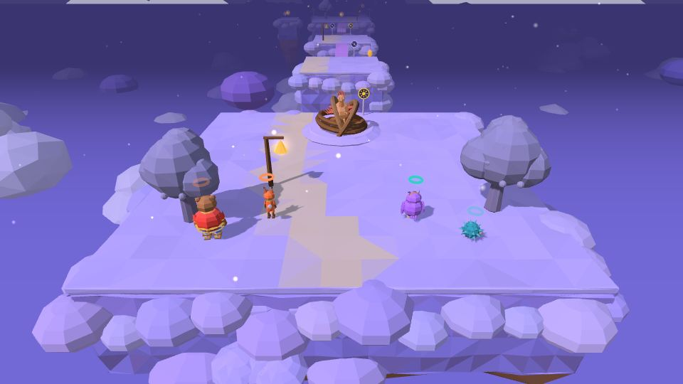
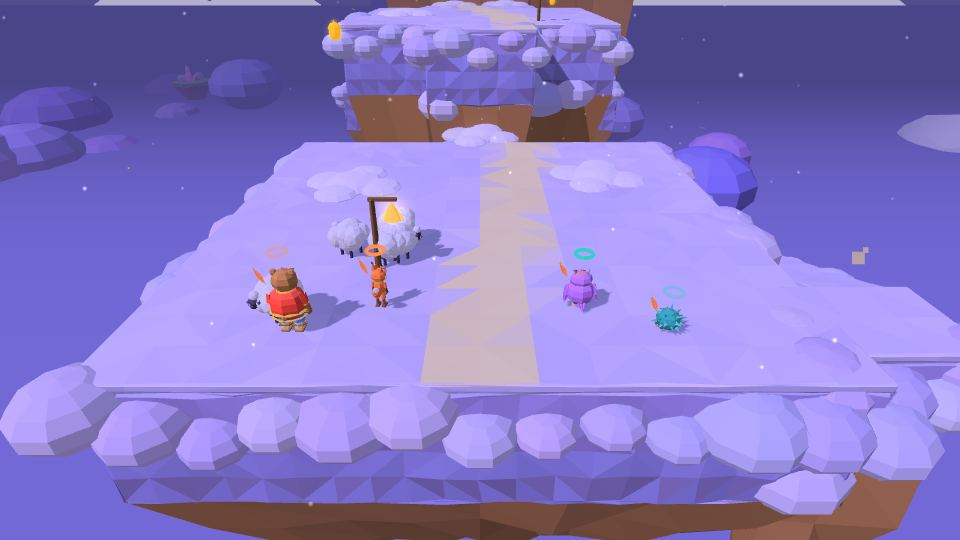
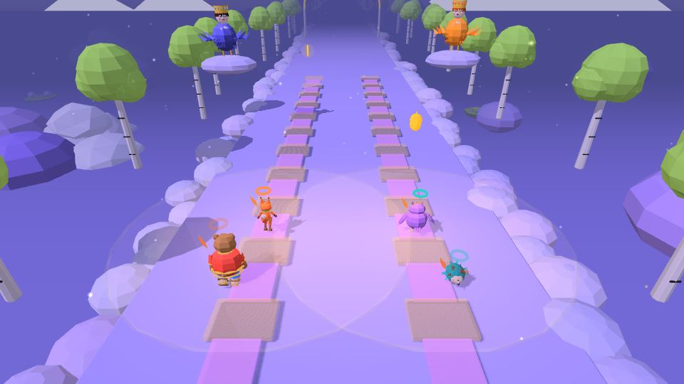
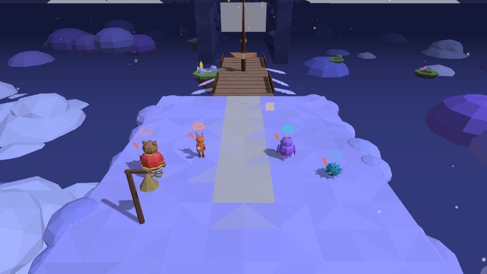
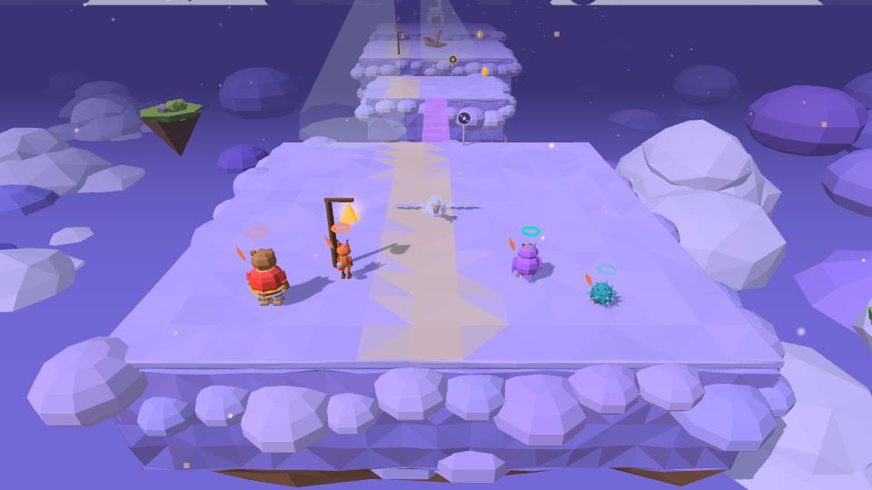
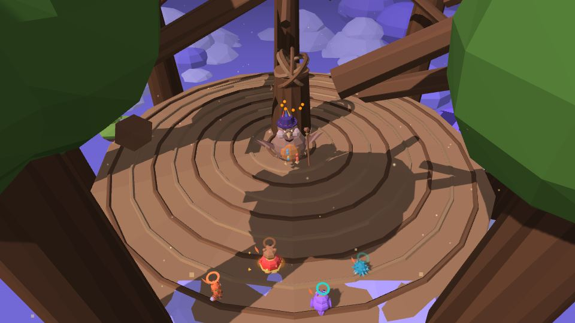

# Мир 3 · Небесное царство

| ☁️ **Небесное царство** | |
|---|---|
| **Чудо-вещь** | 🪶 [перо Жар-птицы](Чудо-вещи#-перо-жар-птицы) — свет |
| **Уровни** | 3-1 · 3-2 · 3-3 🎵 · 3-4 · 3-5 · 3-Б 👑 |
| **Звенья** | 20 |
| **Босс** | Соловей-Разбойник |
| **Особый морок** | Двусветный мотылёк (3-1) |
| **Весточка помощника** | из Сказа 2: Садко (окно в долю шире), Рыба-кит (подшивает издалека), Золотая рыбка (подсказка сразу) |
| **Цвет вышивки** | сиреневый |

В этом мире Ёжик и Лисёнок играют по ещё более слабым детским окнам (замах 0,76 с, отбив 0,37, Пробой 7 с; подсказки в 1,8 раза дольше) — см. [[Бой]]; у длинных задач над полным текстом есть крупная короткая строка (≤ 12 слов), её же читает голос.

**Сохранение на колокольчиках** (3-1 и 3-2 — самые длинные уровни мира): позвонил в колокольчик — игра запомнила участок, звенья и орешки. Вышел и вошёл снова — «Продолжить с колокольчика?»: прыжок — продолжить, щит — сначала. В 3-Б при повторе дорожка пропускается.

Сад над облаками, где стало темно. Пелагея читает по тетрадке уже не шёпотом, а тихо. Светомостки (золотые) держат только в свете, тенемостки (лиловые) — только в темноте.

---

## 3-1 «Сад молодильных яблок»

**Звенья:** 4 · по сказкам «О молодильных яблоках и живой воде» и «Иван-царевич, Жар-птица и серый волк»

- Состарившаяся **Жар-птица** отдаёт последние перья; тени Кощея покрали яблоки.
- Светомостик, тенемостик, «три шага по золотому, три по лиловому» — по одному понятию за раз: перед каждым из трёх первых мостков светлый «призрак» сам проходит его (с горящим пером, с погашенным, потом меняя перо на стыках); серая яблоня оживает от трёх секунд света.
- Тёмные аллеи с тенями и **Двусветным мотыльком** — раскрыт, только когда светят **с двух сторон** (два пера по разные стороны от него, как воришек загоняют; в одиночку — оставленный со светом с одной стороны).
- **Молодильное яблочко**: подойдёшь — в руки, удар — бросок другу; поднесёшь к старому — помолодеет: **Дед-Садовник**, **трухлявый мост**, **Дуб-старик**.
- Светящееся яблочко нельзя пронести по лиловым мосткам — его **перебрасывают**.
- **Спящая стража** — пугала просыпаются от пера и звона струн; **тени-воришки** боятся света.
- Мини-босс **Кощеев Ворон**: ослепить двумя чашами-солнышками и молодить яблочками в воронёнка. Царь-яблоко молодит Жар-птицу.
 

## 3-2 «Облачные пастбища»

**Звенья:** 4 · **Новое:** облака-лифты

- Облако под горящим пером поднимается, в темноте опускается, поднятое тает за 15 секунд. Живая вода Йоши делает облако **пухлым** — держит Потапа.
- Барашки складываются мостиком к свету; грозовые тучки.
- Ягнёнок **Пушок** в грозовой нити — польёт Йоша, и он станет **пружинкой**.
- **Ветер-Ветрило** сдувает и гасит перо — укрытие за Потапом и стожками.
- **Радуга-дуга**: Йоша поливает тучку (толстушку выжимает Потап) — пошёл дождик; зажги перо **рядом с тучкой** (с любой стороны) — встанет радуга, по ней проходят, пока идёт дождь.
- **Овчарня**: девять барашков к свету; мини-босс **Громовой Баран** — отец Пушка.
- **Громовой Баран** — три этапа; перед каждым — обучающие карточки (кнопка на карточке срабатывает по-настоящему), в бою — живые подсказки со стрелкой:
  1. **Таран** — Йоша поливает стожок (пухлый), со светом встань за ним: Баран бежит на свет и вязнет; в свете бей, Потап — за рога.
  2. **Гроза** — Баран тучей наверху, молния бьёт в тень-круг (кувырок или щит). Тучку полить/выжать, перо рядом — радуга; по ней наверх, в свете бей, от кольца по туче — прыжок.
  3. **Пушок** — Баран увяз в стожке — веди Пушка светом пера к батюшке; рядом с бегущим Бараном Пушок пугается.
  - **Как читать бой.** Красная дорожка под Бараном — ровно та полоса, где он собьёт: в ней видно, куда он помчится, а в последние 0,35 с она «запирается» (белые края). Конец дорожки **зелёный** — Баран увязнет в пухлом стожке, оранжевый — разметает сухой, красный — упрётся в стену. Увяз — вокруг стожка кольцо из чёрточек: сколько ещё он стоит. Тёмная искрящая шерсть — сперва посвети; мягкая белая — бей. Над полосой босса — строка, что делать сейчас. Камера сама держит в кадре героев, Барана и Пушка.
 

## 3-3 «Сирин и Алконост» 🎵

**Звенья:** 3 · **Тип:** гусельный раннер на «Во поле берёза стояла», девять частей, темп 84 → 104

Птицы поссорились: Сирин поёт печально и говорит, что её песня правильная, Алконост — весело и спорит. Герои мирят их песней.

Перья вспыхивают в такт — прыгай на вспышку. **Эхо** (повтори за птицей — Сирин показывает рисунок взмахом крыльев), **припев**, **протяжные ноты** (держи прыжок — паришь), **гроза** (щит в такт), **дуэт** (у Прошки ритм Сирин, у Пелагеи — Алконоста), **перья в небе**, **хоровод**. В последнем куплете поёт одна Пелагея.

- **Небо идёт за песней:** сумерки у Сирин, светлеет у Алконоста, темнеет в грозу, рассвет в «Перьях», розовая заря в хороводе, на последнем куплете встаёт солнце.
- **Птицы отвечают:** точный прыжок — вспышка у той птицы, что поёт; промах — птица опускает голову.
- **Подхват:** на пути Ёжика пропущенную долю подхватывает птица — до двух раз за строчку.
- **Перья-оценки:** в конце каждой части — от одного до трёх перьев за точность; три пера в «Грозе» — орешек.
- Музыка — инструментал без пения: гусли, бас, свирель-подголосок у Алконоста, бубен, перебор в «Протяжных», колокольчики в «Перьях».
 

## 3-4 «Летучий корабль»

**Звенья:** 4 · **Новое:** крен палубы, экипаж

- Корабль летит, пока герой со светом стоит у фонаря на мачте (Пелагея-фонарщица). Справа на экране — **высота** корабля: фонарь погас — корабль проседает.
- **Посты экипажа** — каждый участок спрашивает два сразу:
  - **фонарь** — свет, корабль летит;
  - **руль** на корме — кто у руля, ведёт корабль влево-вправо мимо **скал-зубьев** в ущелье (без рулевого — бортом о скалу, корабль тормозит);
  - **балласт** — Потап весит 3, остальные по 1: палуба кренится туда, где больше веса, у **уступов** Потапа переводят к другому борту — метка на уступе зелёная («пройдёт»), если крен верный, красная («заденет»), если нет;
  - **заплатки** — в тёмных тучах парус рвётся, свет утекает и корабль летит медленнее: Йоша поливает живой водой у мачты.
- **Крыло ломается:** Прошка у правого борта прибивает вёдра-крылья в такт (жёлтое кольцо сжалось — удар), Потап держит мачту. Вёдра всё равно улетают — изобретение 3 из 3.
- В тучах прилетает **Ветер-Ветрило** из 3-2: встань со светом на корме — он подует в паруса.
- Мини-босс **Ворона-Ключница** со связкой чёрных ключей: цепляет корабль цепью за борт — крен и просадка. Потап — противовесом к другому борту, золотые звенья цепи — бить (или из рогатки). Цепь лопнула — Ключница на палубе: жёлтое — щит, красное — кувырок, бей. Улетая, роняет чёрный ключ в пропасть.
- Камера в полёте смотрит чуть к тому борту, где опасность, и кренится вместе с палубой.
- В пустом гнезде Гусей-лебедей — клок рыжей шёрстки Тишки.
 

## 3-5 «Гуси-лебеди»

**Звенья:** 5 · **Новое:** стелс — **свет выдаёт**

- От каждого гуся падает белый **луч-пятно** с ободком; впереди — бледный след: туда гусь посмотрит через секунду. Свет пера в пятне гуся не хватает сразу: над гусем растёт **«!»** (0,8 с; на пути Ёжика и в одиночку — 1,2 с, на пути Богатыря — 0,3 с). Погасил вовремя — «Показалось…».
- **Разные гуси:** кружат над мостками; **гусь-сторож** на столбике смотрит то на мосток, то в сторону и считает «раз-два-три» — на «три» поворачивается обратно; **спящий гусь** не видит ничего, пока рядом не шумнут (кувырок, удар, прыжок с разбега), — тогда семь секунд глядит на мосток; **вожак** с золотым клювом ведёт стаю над пропастью.
- **Тишка** едет у Йоши на спине.
- Укрытия по сказке — у каждого своя задача: **печка** — съешь пирожок (отказ — погоня раньше); **яблонька** — кислое яблочко и живая вода, потом **Потап у ствола раздвигает ветви**, и все прячутся под крону; **речка с кисельными берегами** — рогатка по запруде («Это не изобретение. Это меткость!») и Совиный взор, потом гуси пролетают **тремя волнами** — в каждую волну будь под бережком.
- **Над пропастью** мостки по очереди: **золотые** держат только в свете, **лиловые** — только в темноте; перо зажигают и гасят на островках, а друг со светом рядом гасит твой лиловый мосток — держитесь подальше друг от друга. На последнем островке Тишка **вспоминает колыбельную** — гуси засыпают и садятся, как куры.
- Яга на ступе узнаёт героев («Вы ж мне в лесу избушку повернули») и выбрасывает чёрный ключ в пропасть 🔒.
 

## 3-Б «Соловей-Разбойник» 👑

Подход «Прямоезжая дорожка» (≈170 м, свист сдувает — прячься за укрытия и щит Потапа), потом бой в четыре этапа по былине: свист соловьиный, крик звериный, шип змеиный, полный свист. Подробно — **[Боссы](Боссы#-соловей-разбойник)**.

**Таблички и уроки этапов 1–4.** Подсказка — не длиннее семи слов, глагол первым. Одна новая механика — один урок до 25 секунд (карточка ждёт нажатия, через 8 с герои показывают сами; пропуск — прыжок у одного игрока 2 с, «Показать урок ещё раз» — в паузе):
- этап 1: «Белая — прыгай, синяя — щит» → урок «Синяя волна» (Потап, щит), урок «Вода в клюв» (Йоша), на второй половине силы — «Дуб клонится» (полей корни);
- этап 2: «Щитом отрази свет — зайчик!» → урок «Солнечный зайчик» (перо и щит), при первом перескоке — «Совиный взор».
- этап 3: «В вихрь — и верхом на Соловья!» → урок «Вихрь» (Потап подкидывает друга) и урок «Родео» (кренится — жми в другую сторону); петля — «бей колокол на «БОМ»»;
- этап 4: «Выдох — за щит, вдох — в жёлудь!» → урок «Выдох» (все за щит Потапа) и урок «Вдох» (Совиный взор находит золотой жёлудь, Прошка стреляет); «Сдулся» — «Бейте оба разом — мах!».

**После босса** 🔒: **Сказ 3 «Соловьиная песня»**, праздник — и ролик **«Сказок не будет»**: Кощей рвёт цепь на дубе, забирает Звенышко и уходит в море. Дуб стоит голым, Кот молчит.
 

---
← [[Мир 2 · Подводный Китеж|Мир-2-Подводный-Китеж]] · [[Миры]] · [[Мир 4 · Огненная Смородина|Мир-4-Огненная-Смородина]] →
