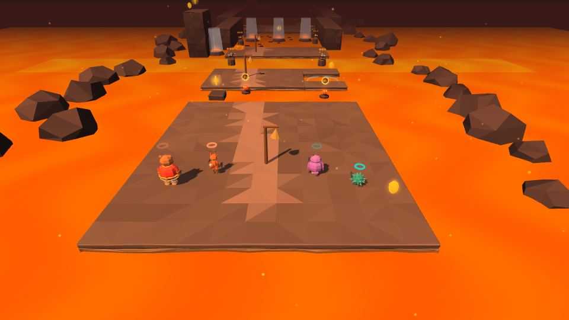
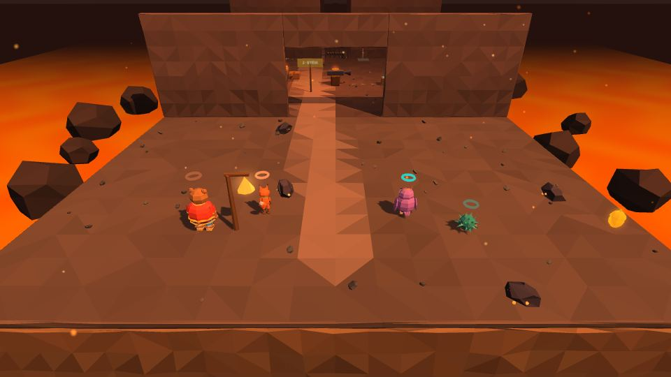
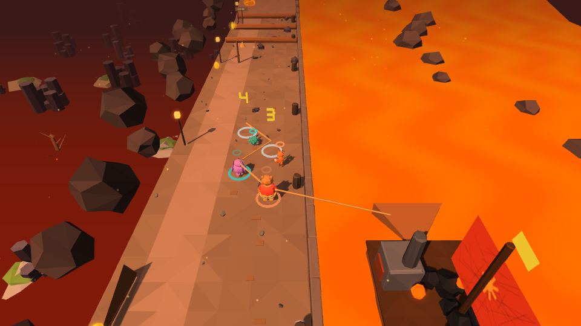
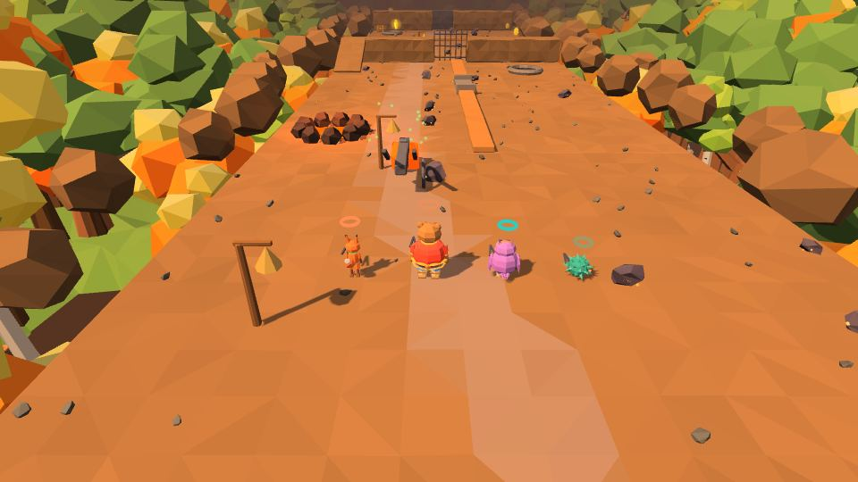
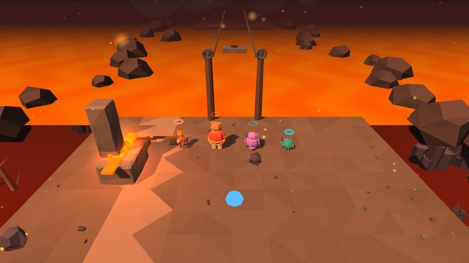

# Мир 4 · Огненная Смородина

| 🔥 **Огненная Смородина** | |
|---|---|
| **Чудо-вещь** | 🔧 [кузнечные клещи](Чудо-вещи#-кузнечные-клещи) |
| **Уровни** | 4-1 · 4-2 · 4-3 👥 · 4-4 · 4-5 · 4-Б 👑 |
| **Звенья** | 20 |
| **Босс** | Змей Горыныч |
| **Особый морок** | Печник (4-4) |
| **Подсказки** | Звенышка нет 🔒 — подсказки читает Пелагея по тетрадке |
| **Весточка помощника** | из Сказа 3: перо Жар-птицы, птичка Сирин или ступа Яги |
| **Цвет вышивки** | огненный |

Огненная река и кузни. Лава здесь — как пропасть: упал — вернёшься к колокольчику, без урона. Горячее берут только клещами; живая вода Йоши остужает.

**Уроки.** Перед каждой новой механикой — короткий урок (5–20 секунд): крупная карточка, одна фраза, кнопка; Пелагея читает её вслух. Урок ждёт нажатия, через 8 секунд показывает сам; пропуск — как у роликов, повтор — «Показать урок ещё раз» в паузе. Уроки: ковка (4-1), корка и перенос корки (4-2), «ух-нем» (4-3), плуг (4-4), «держать мост» (4-5).

**Помощь по промахам.** Не получилось — подсказка растёт по ступеням: короткая строка с кнопкой → строка и стрелка над целью → короткий повтор урока. В начале каждого уровня сказано, что даёт весточка из Сказа 3; над лавой без пера Жар-птицы Пелагея снижается быстро — «Жар крылья не держит!». С весточкой Сирин окно «ух-нем» в 4-3 шире.

**Сюжет мира.**
- **Горыныч нависает над всем миром:**
  - 4-1 — рык из-за реки во вступлении;
  - 4-2 — тень змея проносится над лавопадом;
  - 4-3 — дым на горизонте («Дым на горизонте… Горыныч не спит»);
  - 4-4 — Демьян у своего плуга: «Эти валы мы с Кузьмой на Змее пахали»;
  - 4-5 — огонь сверху.
- **Кузнецы на своих местах:** Демьян встречает у плуга (4-4), Кузьма стоит на берегу у моста: «Мост наш ковали — не подведёт» (4-5).
- **Пелагея читает вместо Звенышка и растёт:** в 4-1 — шёпотом, в 4-3 — громко, на всю баржу. В 4-5 она закрывает тетрадку и говорит своё: «Потап, беги — я вижу целые доски!» В 4-Б Пелагея сама командует в бою.
- **Осколки лубка** — по одному тайнику в 4-2, 4-3, 4-4 и 4-5. Каждый осколок открывает четверть лица ученика: его показывают на последней картинке ролика «Ученик» после Горыныча.

**Свет, звук и эффекты.**
- У каждого уровня свой свет:
  - 4-1 — горн и голубой свет корыта;
  - 4-2 — день над рекой;
  - 4-3 — закат с лилово-розовым небом;
  - 4-4 — осенняя охра;
  - 4-5 — дым и красное небо;
  - 4-Б — ночь.
- **Край земли над лавой** — тёмная застывшая корка и светящаяся полоса, над ней дрожит марево. Так видно, где кончается твёрдое.
- На горизонте видны вехи: впереди — гора Горыныча, справа — Калинов мост.
- **Лава:** на ней вздуваются и лопаются пузыри, по струям бегут полосы — видно, куда течёт.
- **Корка:** встаёт со столбом пара и шипением, а за 3 секунды до конца трескается со звуком.
- **Горячее остывает по стадиям:** сначала светится, потом дымит, а в конце сереет, тикает и показывает надпись «Остывает!».
- **Ковка:**
  - точный удар на долю секунды замирает (hit-stop);
  - удары молота играют мотив «Эй, ухнем»;
  - закалка шипит паром;
  - когда кольцо зазвенело, по всему цеху расходится волна;
  - кузнецы оживают, и по камню бегут светящиеся трещины.
- **Мелочи:** в 4-3 лямка на тяге натягивается и скрипит, из-под баржи летит пыль; в 4-4 у фронта лавы светится «голова», за плугом летят комья; в 4-5 цепи дрожат и скрипят в такт качанию.
- **Музыка:** у каждого уровня своя версия темы мира.
  - 4-1 — наковальня вместо барабанов;
  - 4-3 — медленный бас бурлаков;
  - 4-4 — осенняя арфа;
  - 4-5 — тема Потапа: мотив «Эй, ухнем» в басу.
- **Подписи к звукам** (настройка «Подписи к звукам»): рык Горыныча, шипение корки, «остывает», ящерка набирает огонь, скрип цепей.

**Детям — больше времени.** Если хоть один игрок идёт Ёжиком (Лёгкий путь) или Лисёнком (Средний), головоломки ждут дольше: корка — 11 / 10 с (Богатырю — 8), плита запруды в 4-2 — 9 / 8 с (6), остывшие латы болвана — 14 / 12 с (10), горячее остывает за 30 / 25 с (20), печник горит 8 / 6,5 с (5).

---

## 4-1 «Кузня Кузьмы и Демьяна»

**Звенья:** 4 · **Новое:** ковка клещей

- Кузнецы окаменели. Ковка по станциям **«1 · МЕХИ → 2 · КУЁМ → 3 · ЗАКАЛКА → 4 · ГОТОВО»**: Пелагея качает мехи прыжками, Прошка бьёт в такт (первые клещи — 7 ударов, дальше по 5, третьи и четвёртые — одним двойным циклом), Йоша закаливает в корыте; клещи улетают на стойку — когда там все четыре, каждый герой получает свои.
- Двери жаром: слиток на холодную плиту, уголь в печь подъёмника, горячий гвоздь в щель засова.
- **Чугунные болваны** в раскалённых латах: полить, сорвать нагрудник клещами, бить. Идут волнами: один, потом двое, потом трое.
- **«В четыре руки»**: большую заготовку поднимают вдвоём и куют на большой наковальне; кольцо звенит, как колокол, — и кузнецы оживают. «Хорошо сковано. Вчетвером?»
 

## 4-2 «Река Смородина»

**Звенья:** 4 · **Новое:** корка на лаве

- Живая вода по лаве — **корка** 1,2 × 2 м держит 8 секунд (Ёжику — 11, Лисёнку — 10) и мигает перед тем, как утонуть.
- У каждого своё дело: Йоша делает корку, Прошка прикрывает рогаткой от ящерок, Потап ловит и подкидывает.
- **Ящерки** плюют по одной. Перед плевком ящерка 1,2 с светится и пищит — Прошка успевает её сбить. На пути Ёжика плевок не сбивает Йошу с корки, а только отнимает у корки 2 секунды.
- Бурлящая струя: корку делают в тихой заводи и несут клещами; на широком разливе корка — плот.
- Пока корка в клещах над лавой, светится **рамка**, куда она ляжет: стоя — прямо перед героем, на бегу — там, куда долетит бросок.
- Паровые столбы, горячий камень в жерло — столб как лифт.
- **Лавопад в три яруса**: «Сиди тут. Я сам найду обход.» — «Потап, смотри на меня. Я пойду. Если что — ловишь.» Ролик открывается кадром с крана над каскадом.
- Пока Йоша спускается, Потап считает вслух. Внизу счёт кончается словами «Всё. Внизу. Дошёл, Йоша!» и аккордом.
- Огненная завеса и запруда со щеколдой.
 

## 4-3 «Эй, ухнем» 👥

**Звенья:** 3 · **Тип:** на четверых

- Потап запевает «Эй, ухнем»; на **«ух-нем»** все жмут RT — каждый герой в кольце добавляет силу, все четверо — рывок. Лямку держит и оставленный.
- Песня звучит голосом: запев Потапа басом, на «ух-нем» отвечает хор, и голос каждого попавшего героя вступает в хор.
- **Темп по куплетам:** такт сначала 2,6 с, по ровному берегу 2,3 с, в гору 2,9 с. Окно «ух-нем» — 1 с, на пути Ёжика — 1,2 с.
- **Перекличка** (пути Лисёнка и Богатыря): игрок, у которого Потап, сам запевает «Эй» своей кнопкой — такт ждёт его. Не запел за 0,8 с — запев идёт сам. На пути Ёжика запев всегда сам.
- Три «Рывка» подряд — хор кричит **«Раззудись!»**, и три такта баржа идёт в полтора раза быстрее.
- **Мель** посреди берега: баржа садится, и сдвинуть её можно только двумя «Рывками» подряд — все четверо в кольцах. На пути Ёжика «Рывки» могут идти и не подряд.
- Брёвна на пути: кольцо проходит, только если его герой прыгнул.
- В гору баржа идёт только с огнём: двое держат лямку, двое носят уголь клещами в топку (три угля — 30 секунд).
- На горе **ящерка на свае** плюёт в того, кто несёт уголь. Перед плевком она 1,2 с светится; попала — уголь выпадает из клещей. Прошка (вне лямки) сбивает её рогаткой RT мимо такта, и 10 с она не плюёт (на пути Ёжика 14 с).
- Кузьма встречает баржу у ворот и снимает шапку.
 

## 4-4 «Змиевы валы»

**Звенья:** 4 · **Новое:** плуг и борозды

- Клещами за раскалённый лемех — **плуг** едет за героем и пашет борозду; лава течёт по бороздам со скоростью шага.
- Совиный взор показывает, куда лава хочет течь; мёртвая вода Йоши — борозда зарастает.
- Чугунную дверь Потап вышибает плечом; **змеёныши** в лаве сильные, на сухом ленивые.
- **Печник**: остывший неуязвим — уголь из жаровни клещами, и он горит 5 секунд (Ёжику — 8, Лисёнку — 6,5).
- Пока плуг в клещах, видно, какие клетки он пропашет. Живая вода Йоши на лаву в борозде — корка: клетка остывает, по ней можно пройти, поток там стоит. Мёртвая вода стирает сухую борозду.
- Перед чугунной дверью — первый печник, один на один у жаровни. На арене сначала змеёныши; когда лава ушла в яму — болван и печник.
- Третья, необязательная чаша в поле А: доведи до неё лаву — на валу загорится огненный узор.
 

## 4-5 «Калинов мост»

**Звенья:** 5 · **Новое:** асимметричная сцена

- Жёлуди по крюкам опускают цепи; калёные доски клещами на цепи, Йоша сращивает стыки.
- Кикимора: «Должна была — отдаю».
- **Держать мост** (Игрок 1, Потап): стик против качания, синие капли — щит, красная дрожь — упереться. «Не сила богатыря держит — земля его держит».
- **Переход** (Игрок 2): стыки чинит Йоша, пролёты перелетает Пелагея.
- Мост держат, пока Пелагея и Йоша не перейдут, но не меньше 25 секунд; перешедшая Йоша гасит капли огня живой водой.
- «Иди. Я держу» — бег Потапа по рушащемуся мосту: Йоша сращивает треснувшие доски, а живая вода снова кладёт корку на лаву. «Ты держал». — «А ты чинил».
- Колокольчики — у начала, в конце первой половины моста, у ворота и на том берегу.
 

## 4-Б «Змей Горыныч» 👑

Три головы — три запала, вдох и узда. Подробно — **[Боссы](Боссы#-змей-горыныч)**. Подсказки в бою растут с промахами: мигает кнопка → карточка и стрелка → короткое напоминание, где приём показывают герои.

**Обучение этапа 2** — три коротких урока (до 25 секунд, одна механика в каждом), каждый — перед тем, как приём понадобится; пропуск — прыжок: вдвоём 1 с, одному 2 с, в паузе — «Показать урок ещё раз»:
1. **Жёлудь** — Прошка стреляет из рогатки в жёлудь над средней головой (урок идёт при входе в этап).
2. **Огонь и вода** — Потап поднимает широкий щит от огня, Йоша поливает сытую голову живой водой (при первом огне или сытой голове).
3. **Вдох и взор** — на большом вдохе держим щит; Пелагея включает Совиный взор и бьёт по чешуйке (перед первым большим вдохом).

**Трещины после рыка.** Когда средняя голова рычит (начало этапа 2), у краёв арены, слева и справа, раскрываются огненные трещины-подковы. За каждой — уступ с огненным цветком: дотронься — лепесток и искры. В трещину не ступить: жар отталкивает. Её можно перепрыгнуть или перелететь, а Йоша живой водой кладёт на неё корку-мостик, как на реке Смородине. Мостик держится, как корка в мире 4, и трескается за 3 секунды до конца. С уступа назад выходят свободно. Бой от трещин не зависит — это только удобство.

**После босса** 🔒: полёт на спине Горыныча, ролик **«Ученик»** (головы рассказывают на лубках про мальчишку с молотом), **Сказ 4 «Одно сердце»**. Горыныч дремлет у моря — теперь он друг.
 

---
← [[Мир 3 · Небесное царство|Мир-3-Небесное-царство]] · [[Миры]] · [[Мир 5 · Остров Буян|Мир-5-Остров-Буян]] →
