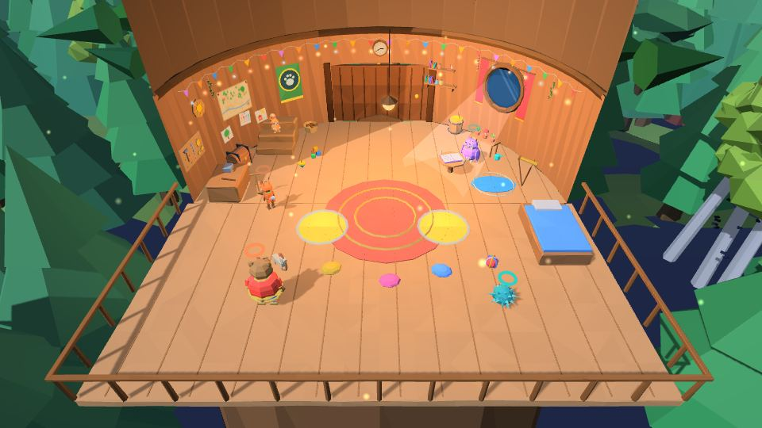

# Пролог «Звенышко»

| **Пролог** | |
|---|---|
| **Где** | штаб-сосна «Лесного патруля» |
| **Чему учит** | прыжок, смена героя, «Ко мне!», свой приём, «оставленный держит», первый бой |
| **Длительность** | ~10 минут |
| **Переиграть** | всегда открыт первым в списке «Дремучего леса» на карте |

## «Присказка» — вступительный ролик
Новая игра начинается с ролика «Присказка» (≈ 2 мин 20 с, семь сцен). Кот Учёный сказывает у дуба на Лукоморье — том самом, что ждёт героев в игре: с деревней, Заставой и мельницами, — и из его слов Кузьма куёт звенья Златой цепи: волшебный деревянный молоточек сам слетает с крюка ему в лапу. Слова сказки золотыми буквами кружат над слушателями у дуба и улетают над морем, а камера летит за ними к лесу мира 1, где в штабе-сосне Лесной патруль готовится ко сну: Прошка стреляет из своей катапульты яблоком, Потап ловит его, Йоша поливает из лейки засохший цветок — и тот расцветает, Пелагея пишет сказку в тетрадь (и зачёркивает), а Тишка в ночном колпаке, с подушкой, зевает и просит сказку. Ночью за морем кто-то холодный слушает, как в каждой сказке «Кощей, как водится, проиграл». Потом приходит лиловая туча, и звенья разлетаются по пяти мирам — в каждом нас уже ждёт хозяин: встаёт из чащи Леший-великан, над куполами Китежа кружит Водяной верхом на соме, на гнезде из семи дубов свистит Соловей-Разбойник, Горыныч на Смородине пышет огнём, а на Буяне у дуба с сундуком открывает свой единственный глаз Лихо Одноглазое. Пелагея видит в подзорную трубу, что одна искра летит прямо к их сосне. «Это присказка, не сказка. Сказка — будет впереди!»

Ролик поставлен вручную, как мультфильм: в каждой сцене есть общие, средние и крупные планы, камера ездит, взлетает краном и облетает героев. У Кота Учёного живой хвост и подрагивающие уши. Удары молота, щелчок звена и разрыв цепи на миг замирают («стоп-кадр»): огромная костлявая рука выходит из грозовой тучи, тянет цепь рывками, звенья раскаляются, Кот держит цепь лапами — и она лопается с ударной волной. Русалка появляется на ветке с брызгами, а Кощей свою реплику говорит крупным планом, лицом к зрителю.

Ролик пропускается, как любой другой: удержать кнопку прыжка. Посмотреть заново — «Главы» → «Присказка». Сценарий — `zlataya_cep/docs/42_priskazka_intro.md`.

## Сюжет
Вечер в штабе-сосне. Ролик **«Колыбельная»**: бельчонок Тишка поёт и забывает слова; [[Пелагея]] — сказительница, которая знает сказки только по тетрадке, — глядит в неё (колыбельной там нет), чешет пером за ушком, вспоминая, смущается до румянца и тихонько вздыхает. Потом что-то звенит в темноте — это **Звенышко**, живое звено Златой цепи. Друзья бегут за ним.

## Прохождение
1. **Погоня по веткам.** Первая трещина — первый прыжок игры: камера поднимается над кроной и показывает её целиком, над трещиной светится дуга-стрелка, на том краю — кольцо. До первого прыжка герой у края не соскальзывает.
2. **Смена.** Уступ, овраг, корень — здесь учатся переключаться между своими героями. Лесенку для [[Потапа|Потап]] скидывает кнопка, на которую встаёт [[Прошка]].
3. **Старая калитка** — свой приём: рогатка Прошки и ковшик Йоши.
4. **Тропинки расходятся** — каждый игрок идёт своей.
5. **Жёлтые плиты** — главный урок игры: **«оставленный держит»**. Поставьте одного героя на плиту, переключитесь — он так и стоит.
6. **Первый морок** — колючий клубок: щит в такт и удар (см. [[Бой]]).
7. **Дупло** — и ролик **«Лукоморье»**.

## Ролики-уроки
Основы управления в прологе объясняют сами герои — четырьмя короткими роликами (9–20 с), прямо перед тем, как приём понадобится:

| Ролик | Где | Что показывают |
|---|---|---|
| **Прыжок** | первый герой подошёл к трещине | Звенышко скачет к краю и перелетает по дуге прямо в кольцо. Прошка: «Упадёшь — не беда: колокольчик вернёт сюда!» |
| **Двое героев** | все перепрыгнули, развилка | Пелагея: «Двое у каждого из нас — меняй, кто нужен сейчас!». Потап убегает, Прошка остаётся: «Эй! А я стою и жду?» — «Постой чуток — я позову!» |
| **«Ко мне!»** | Прошка скинул лесенку (или Пелагея у засохшего корня, а Йоша далеко) | Прошка кричит «Потап, ко мне!» — и Потап **сам** бежит к нему по лесенке наверх. Звенышко: «Крикни «Ко мне!» — друг прибежит, хоть где стоит!» (в одиночной игре — «все трое прибегут»). После ролика друг уже рядом и идёт следом. Ролик один на двоих: второму игроку, когда он дойдёт до своего «Ко мне!», — только карточка |
| **Бой с мороком** | начало поляны, до мороков игроков | Показательный морок: над ним солнышко — Потап закрывается щитом и отбивает удар, угольки гаснут, Прошка бьёт — **ПРОБОЙ!** — и добивает. Йоша: «Теперь вы сами — посмелей!» — и выкатываются два морока игроков |

После каждого ролика на 7 с появляется карточка урока: значок, одна фраза и кнопки обоих игроков. Она видна и при выключенных подсказках и читается вслух. Ролики идут при каждом заходе в пролог и пропускаются, как любой ролик (удержать прыжок); последний урок можно посмотреть ещё раз — пауза → «Показать урок ещё раз». Реплики озвучены голосами героев (ElevenLabs).

## Урок «подсказки — на кнопке»
Подсказки в игре по умолчанию выключены. Через пару секунд игры в прологе по центру экрана появляется крупная карточка: «Подсказки спрятаны. Нужна подсказка — нажми **LB**» (на клавиатуре — **H**). Нажали — подсказка показалась, карточка просит нажать ещё раз, чтобы её спрятать; нажали — «Получилось!», и через 5 секунд урок уходит. Не нажали за 40 секунд — карточка уходит сама. Если подсказки включены в паузе («Подсказки: вкл»), урока нет. Подробнее — [[Управление]].

## Лукоморье
Из дупла герои выпадают на [[Лукоморье]] — из золотого кольца над поляной, следом вылетает Звенышко. Ролик прибытия (~25 с): на дубе нет цепи, висит только обрывок; **Кот Учёный окаменел** — как в книжке-раскладушке Пелагеи. Звенышко звенит у его уха — Кот оживает и рассказывает: Кощей порвал цепь и разметал звенья по сказкам, уцелело одно Звенышко — звенья надо найти. Звучит присказка «Звено куют руками, а держится оно словами» («Скуёте — поймёте!»), Кот показывает на море: дорога — на рушнике.

После ролика у **волшебного стана** у моря светится кольцо, а Звенышко ведёт к нему. Встаньте в кольцо и нажмите прыжок — из веретена раскатывается **карта-рушник**, и начинается ролик «Пять миров»: Звенышко ныряет в Дремучий лес и за ним — герои.

→ Дальше: **[[Мир 1 · Дремучий лес|Мир-1-Дремучий-лес]]**
