# «Златая цепь» — визуальный стиль игры для Unreal Engine 5.8: арт-ресёрч и пробы (октябрь 2026)

Цель — выбрать финальный визуальный стиль **игры** (не мультсериала): персонажи, окружение, интерактив, магия. Игра будет
собираться в Unreal Engine 5.8. Предыдущий ресёрч — `41_art_research_prompts.md` (5 стилей × 159 сущностей в Qwen Image,
сделана 371 картинка, выбор не сделан). Этот документ сужает поиск: **одна и та же игровая сцена** в восьми стилях и сочетаниях
(ChatGPT), оценка по критериям игры, листы героев в лидирующих стилях и план проверки в движке.

Картинки — `wiki/images/game_style/` (уменьшенные JPG). Промпты — раздел 6.

## 1. Что требует от стиля сама игра

| Ограничение | Откуда | Что это значит для стиля |
|---|---|---|
| Кооп-платформер для детей 7–10 и семей, камера сзади-сверху, 5 миров | `46_multserial.md`, `02_art_bible.md` | силуэт героя и путь читаются с 6–10 м; интерактив выделяется цветом (жёлтое = «твоё») |
| Экран на двоих | `37_split_screen.md` | каждый кадр рисуется дважды — бюджет на шейдеры, траву, частицы делится пополам |
| Пять разных миров (лес, подводный Китеж, небо, огненная Смородина, Буян) + Лукоморье | `02_art_bible.md` | стиль должен давать разные «материалы мира», а не одну фактуру на всё (урок It Takes Two) |
| Мороки пугают понарошку, Кощей грустный, не страшный | `40_kino_pravila.md` | никакого хоррор-реализма; враги — игрушечные |
| Мультсериал уже в стиле «бумага + фетр» | `47_mult2d_stil.md`, `art/ser01v4/` | игре выгодно быть «той же сказкой в 3D»: герои узнаются сразу |
| Малая команда | — | процедурные материалы, мало уникальных текстур, переиспользуемые киты |

## 2. Референсы: что берём

| Игра | Движок | Что работает | Что берём |
|---|---|---|---|
| **Sackboy: A Big Adventure** (Sumo Digital) | UE4 | мир из ткани, картона, ниток; уровни собраны сплайн-инструментами прямо в движке; вершинная анимация для массовки; 60 FPS с самого начала; общая камера на 1–4 игроков | ремесленные материалы, сплайн-киты, 60 FPS как правило, вершинная анимация мороков |
| **Yoshi's Crafted World** (Good-Feel) | UE4 | вся сцена — настольная поделка: картон, фетр, скотч, коробки; tilt-shift «миниатюры» | ощущение игрушечной диорамы, тот же материал у героя и мира |
| **It Takes Two / Split Fiction** (Hazelight) | UE4/5 | у каждого героя — форма и своя палитра (треугольник/круг); каждый уровень — свой материал мира; бюджет экрана на двоих решается заранее | язык форм героев (Прошка — треугольник, Потап — круг, Пелагея — яйцо), «материал мира» на каждый мир, план бюджета под раздел экрана |
| **Tearaway** (Media Molecule) | собственный | мир из бумаги со складками, рвущиеся бумажные враги | бумажная магия и мороки, которые «рвутся» |
| **Kirby and the Forgotten Land, Astro Bot** | собственные | игрушечные формы, мягкий свет, огромная читаемость с игровой камеры | читаемость: крупные формы, мало мелочи на пути |
| **Trine, Kena: Bridge of Spirits** | собств./UE4 | живописный стилизованный PBR, объёмный свет, лес как живая картина | атмосфера леса, объёмный свет — для фона, не для пути |
| **Билибин, Палех, богородская игрушка, городецкая роспись, «Гора самоцветов» (пластилин)** | — | узнаваемая «русская сказка» с первого взгляда | орнамент по краю формы, лаковая ночь Кощея, резная игрушка |

**Unreal Engine 5.8 — что важно для стиля** (по анонсу 5.8): Lumen Lite (до 2× быстрее Lumen High, цель 60 FPS вплоть до
Switch 2), MegaLights в продакшене (много динамических светильников — светлячки, фонари), **встроенный toon-шейдер** для
cel-shading, Fog Screen Space Scattering (объёмный туман и пыль). Отсюда: стилизованный PBR и тун-стили одинаково посильны; для
экрана на двоих — Lumen Lite и вершинная анимация.

## 3. Пробы: одна сцена — восемь стилей

Сцена во всех пробах одна: мир 1 «Дремучий лес» в сумерках, тропа из камней, Прошка бежит, Пелагея летит рядом, впереди
жёлтая плита и колокольчик, Звенышко с золотой нитью ведёт, избушка на курьих ножках спиной, сосны, светлячки, мороки-клубки.

Восемь проб — шесть «чистых» стилей и два сочетания. Каждая — отдельный новый диалог ChatGPT (в одном диалоге картинки
тянутся к предыдущей и стили сливаются), к каждой приложен лист героев из мультсериала.

| # | Стиль | Кадр | Что получилось |
|---|---|---|---|
| 1 | **Фетр и шерсть** (Sackboy, Yoshi) | 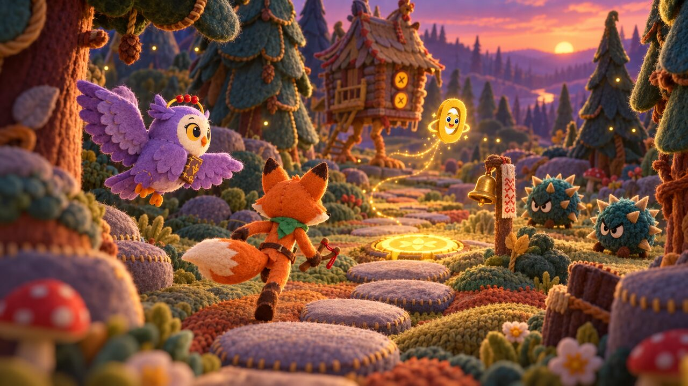 | всё вязаное и валяное: тепло, «трогательно», герои узнаются; но мир из одной фактуры — путь и фон сливаются, пять миров будут похожи |
| 2 | **Резное дерево** (богородская игрушка) | 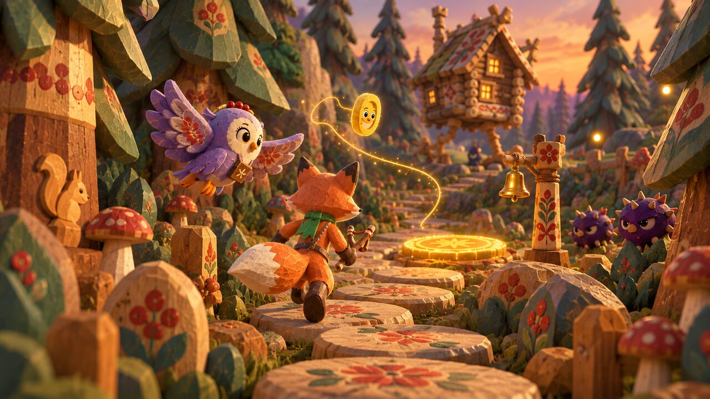 | расписные пни-ступени, резные сосны — очень «наше»; герои по-прежнему мягкие — дерево хорошо для мира, не для героев |
| 3 | **Билибин, тун** (контур, плоские тона) | 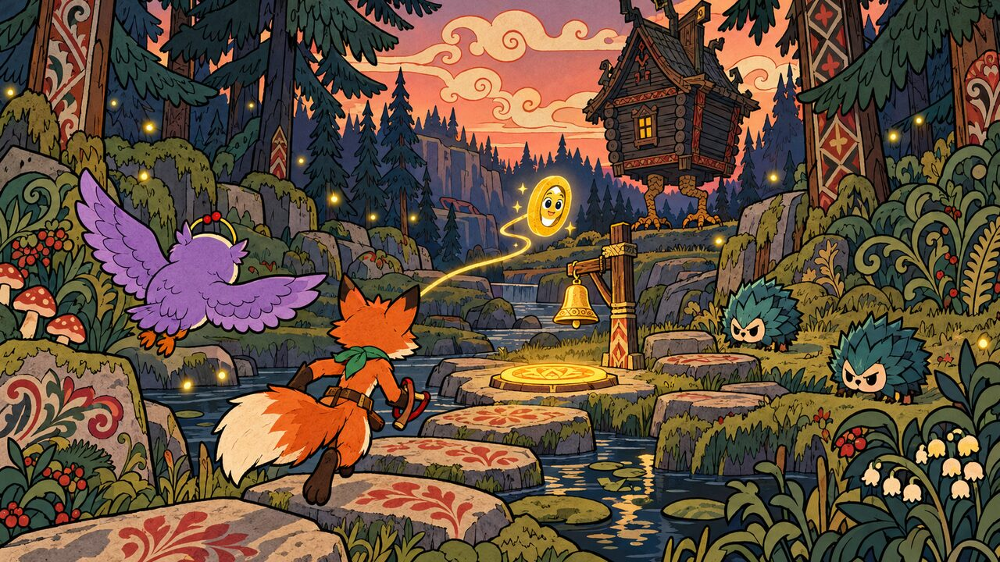 | самый «книжный» и самый дешёвый в движке (toon-шейдер UE 5.8); орнамент-контур делает кадр шумным, глубины мало, на маленьком экране на двоих рябит |
| 4 | **Палех, лаковая ночь** | 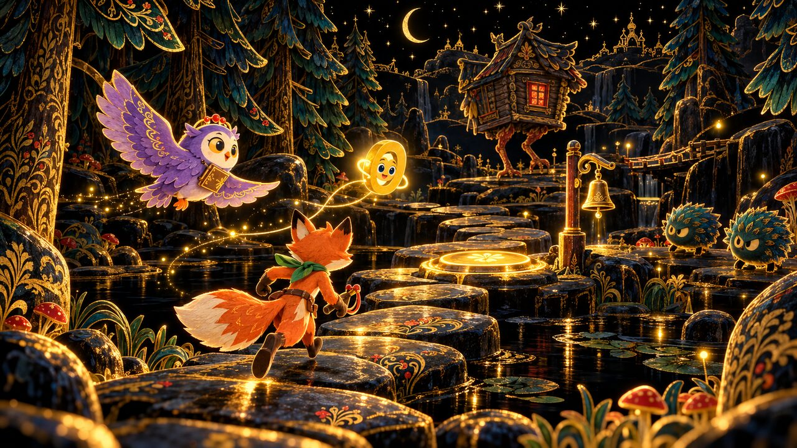 | чёрный лак и золото — эффектно, но это стиль одной ночи, а не всей игры: детям 7–10 темно, путь читается только по золоту |
| 5 | **Живописный стилизованный PBR** (Trine, Kena) | 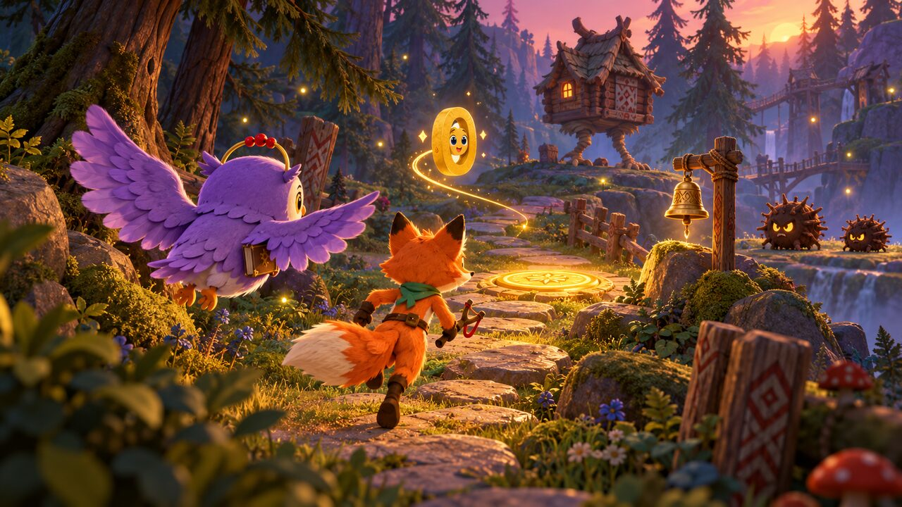 | красивее всего как картинка, объёмный свет, водопады; узнаваемости «русской сказки» почти нет — может быть любой фэнтези-игрой |
| 6 | **Пластилин** («Гора самоцветов») | 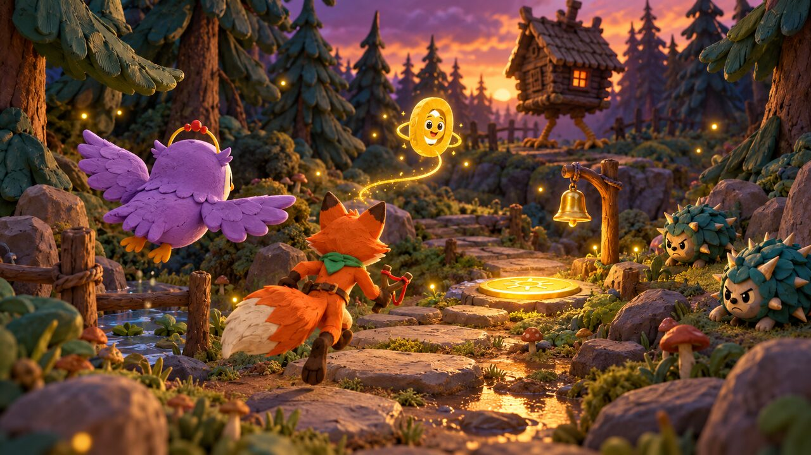 | ChatGPT не удержал материал — вышел тот же живописный стиль; отдельной ценности не показал |
| 7 | **Сочетание: фетровые герои + живописный мир** | 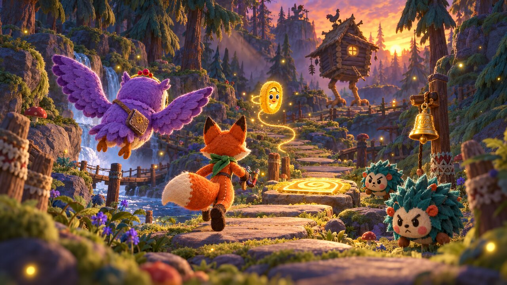 | герои «игрушечные» и тёплые, мир глубокий; лучший по атмосфере, но мир — снова общий фэнтези-лес |
| 8 | **Сочетание: «Расписная шкатулка»** — фетровые герои в мире из расписного дерева и папье-маше | 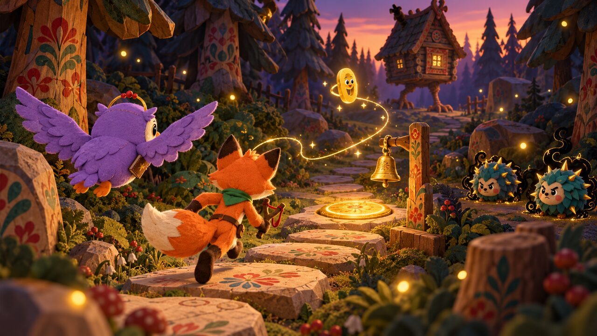 | самый узнаваемый: камни-ступени расписаны городцом, стволы — хохломой, мороки клубками; путь светлее и проще фона — читается |

**Листы героев** в трёх лидирующих направлениях (тот же лист мультсериала):

| Фетр | Расписное дерево | «Билибин» |
|---|---|---|
| 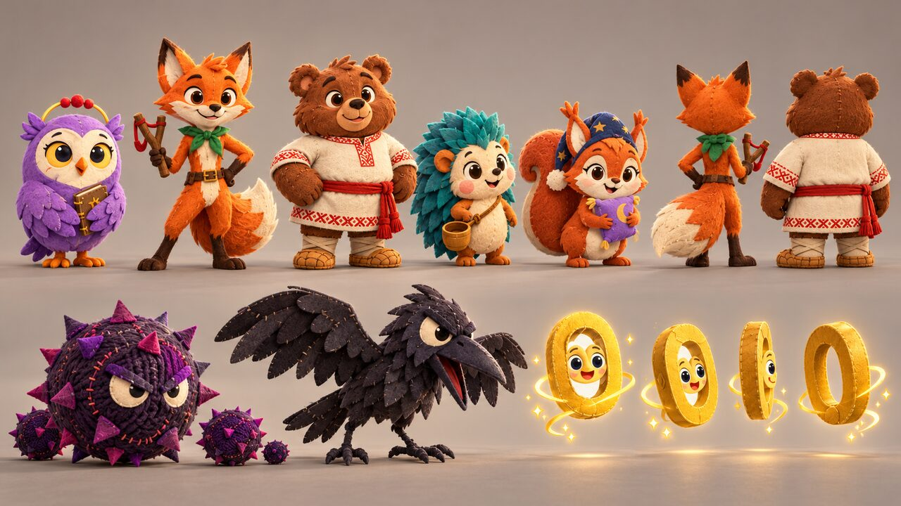 | 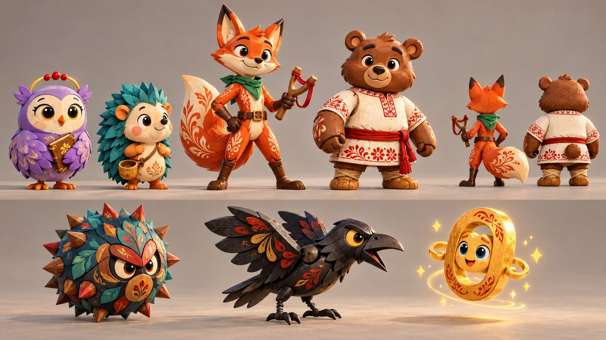 | 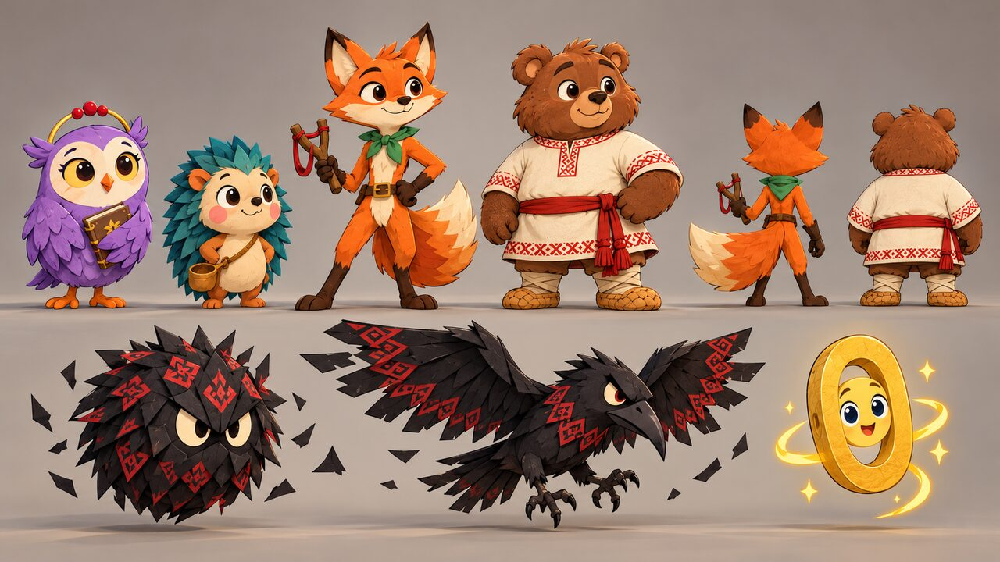 |
| лучший: мягкие формы, швы, пуговицы, Звенышко — полированное золото | хохломской узор по хвосту и рубахе Потапа — хорошая деталь, но герои становятся «лакированными», теряется тепло | ChatGPT не дал тун на героях — вышел тот же фетр; зато **мороки из чёрной бумаги с красным орнаментом** — лучшая находка для врагов |

Вывод по листам: герои — **фетр** (во всех трёх ChatGPT сам к нему тянется — это и есть «их» материал из мультсериала);
орнамент на героях — только вышивкой на одежде (рубаха Потапа, шарф Прошки), не по меху.

**Проверки выбранного сочетания (8)**:

- *Пять миров* — у каждого своя школа росписи: Лукоморье — городец и резьба, Лес — городец по дереву, Китеж — **гжель**
  (бело-синий), Небо — **мезенская** роспись, Смородина — **хохлома** (чёрный, красный, золото), Буян — белый камень и
  вышивка. Сравнение с тем же листом в живописном стиле 7 — сверху: 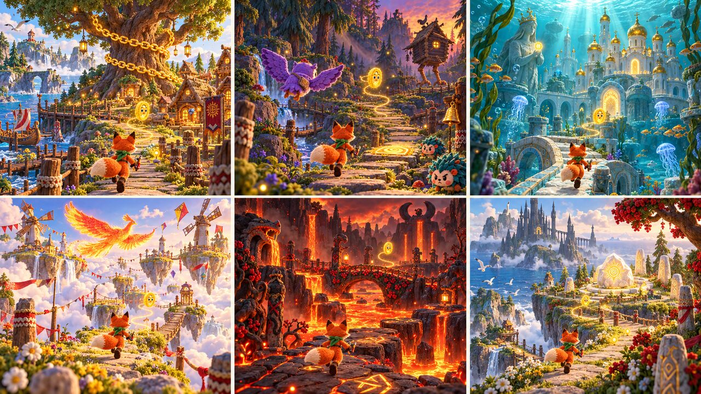 снизу (8): 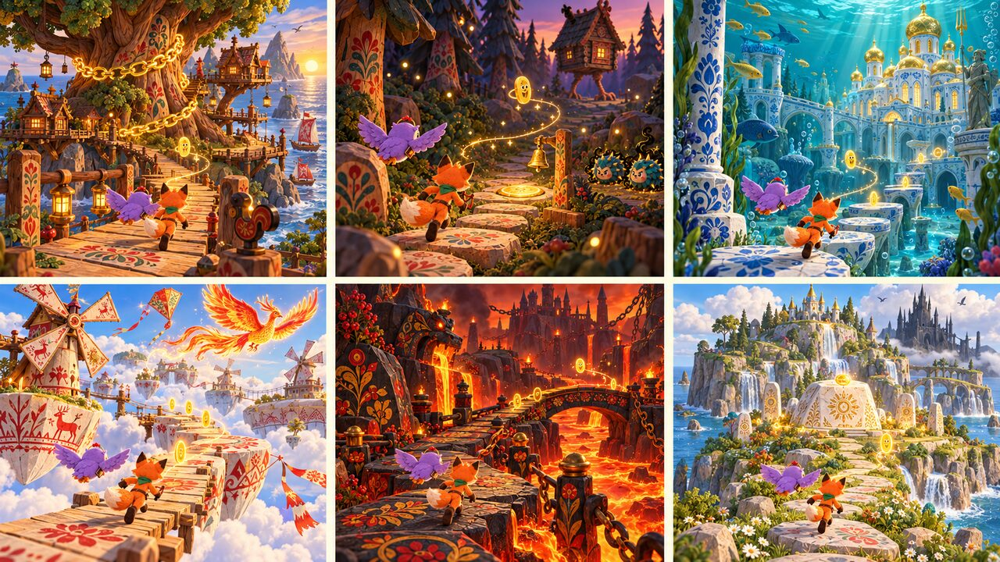
- *Экран на двоих* — при приглушённом орнаменте за героями и светлом простом пути оба героя читаются в половине кадра:
  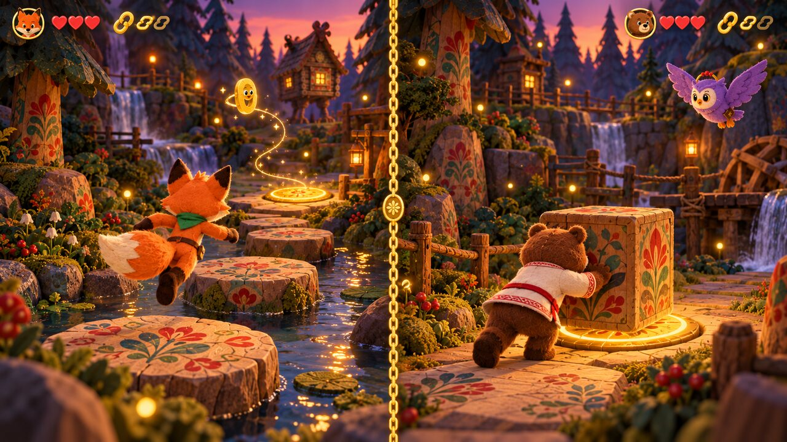
- *Кощей и мороки* — «ночной материал»: чёрный лак, тёмный фетр, серебристо-синий орнамент; у каждого морока одно золотое
  слабое место. Против тёплого мира читается мгновенно: 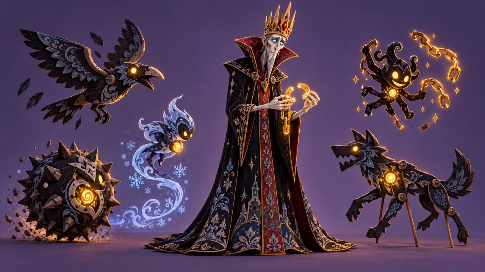

## 4. Оценка

Оценка 1–5 (5 — лучше). «Движок» — насколько дёшево и надёжно это сделать в UE 5.8 малой командой при 60 FPS на экране на двоих.

| Критерий (вес) | 1 Фетр | 2 Дерево | 3 Билибин | 4 Палех | 5 Живопись | 7 Фетр+живопись | **8 Шкатулка** |
|---|---|---|---|---|---|---|---|
| Узнаваемость «русской сказки» (×3) | 3 | 5 | 5 | 5 | 2 | 3 | **5** |
| Читаемость героя и пути с игровой камеры (×3) | 3 | 4 | 3 | 3 | 4 | 4 | **4** |
| Разнообразие пяти миров (×2) | 2 | 3 | 3 | 1 | 4 | 4 | **5** |
| Связь с мультсериалом (×2) | 5 | 3 | 3 | 2 | 2 | 4 | **4** |
| Привлекательность для детей 7–10 (×2) | 5 | 4 | 3 | 3 | 4 | 5 | **5** |
| Движок: стоимость, 60 FPS на двоих (×2) | 3 | 4 | 5 | 4 | 2 | 2 | **4** |
| **Итог (из 70)** | 46 | 55 | 54 | 46 | 42 | 51 | **64** |

Почему «Движок» у живописи 2: объёмный свет, туман, густая трава и уникальные текстуры на каждый камень — дорого вдвойне при
двух камерах. У «шкатулки» 4: формы простые (низкая геометрия, скосы), роспись — это **трафареты-декали и маски в одном
мастер-материале**, а не уникальные текстуры; фетр — один материал с картой ворса и fuzzy-shading.

## 5. Рекомендация и что делать дальше

**Рекомендация: «Расписная шкатулка»** — фетровые герои в мире из резного расписного дерева и папье-маше, у каждого мира
своя школа народной росписи; мороки и Кощей — «ночной материал» (чёрный лак, тёмная бумага, серебро); всё интерактивное — тёплое
золото. От живописного стиля 7 берём только свет: мягкий объёмный закат и туман на дальних планах.

Правила стиля (черновик для `02_art_bible.md`):

1. **Три материала — три смысла.** Фетр = герои и друзья. Расписное дерево/папье-маше = мир. Чёрный лак = мороки и Кощей.
   Золото = «можно трогать» (плиты, колокольчики, звенья, слабые места врагов).
2. **Путь проще фона.** Ступени и платформы — светлое дерево с крупным редким узором; густой орнамент — на стенах, стволах,
   дальних планах. Вокруг героя орнамент приглушён (насыщенность −30 %, размытие узора по расстоянию).
3. **Одна школа росписи — один мир**: Лукоморье — городец, Лес — городец + резьба, Китеж — гжель, Небо — мезень, Смородина —
   хохлома, Буян — белый камень и вышивка-оберег.
4. **Формы игрушечные**: скосы и скругления на всём, ничего острого у героев; язык форм — Прошка треугольник, Потап круг,
   Пелагея яйцо.
5. **Свет** — тёплый закатный ключ + холодный заполняющий; ободок (rim) на героях всегда, чтобы отделить фетр от росписи.

**Что это значит для Unreal Engine 5.8**

| Задача | Решение в UE 5.8 |
|---|---|
| Фетр героев | один мастер-материал: Subsurface Profile/Cloth shading, карта ворса + fuzzy-френель, нормаль швов; Groom не нужен |
| Роспись мира | мастер-материал «расписное дерево»: база-дерево + 4–6 трафаретов узора в атласе (маски по UV2/триплан), цвета узора — параметры мира; лак — clear coat |
| Пять миров | Material Instance на мир (палитра школы росписи), набор модульных китов «шкатулка» (ступень, пень, забор, изба, мост) — сплайн-инструменты как в Sackboy |
| Мороки | вершинная анимация (Vertex Animation Textures) для толпы, ночной лак — тот же мастер-материал с тёмной палитрой и эмиссией слабого места |
| Свет и бюджет на двоих | Lumen Lite + MegaLights (светлячки, фонари, золото), Fog Screen Space Scattering для дальних планов вместо тяжёлого объёмного тумана; Nanite для китов; цель 60 FPS на двоих с первого прототипа |
| Читаемость | пост-процесс: приглушение насыщенности по маске вокруг героя, outline не нужен (rim + золото работают) |

**Дальше**

1. Тестовая сцена в UE 5.8: 30 м тропы «Дремучий лес» — 6 модулей шкатулки, Прошка-фетр (бег, прыжок), 3 морока,
   колокольчик и плита; замер FPS на двоих.
2. Лист материалов: фетр (3 цвета), расписное дерево (городец), лак (ночь) — на шарах, для сверки движка с концептом.
3. Расширить лист героев до поворотов (перед, бок, спина) — фетр; Кощея упростить к мультсериалу (менее «взрослое» лицо).
4. После теста — перенести правила в `02_art_bible.md`, страницу вики «Визуальный стиль игры».

## 6. Промпты (ChatGPT, каждая проба — новый диалог)

Общее начало промпта сцены (к нему приложен лист героев `cast_lineup.jpg`):

> Art research for the 3D GAME 'Golden Chain' (Russian fairy tales, co-op 3D platformer for kids 7–10 and families, to be built
> in Unreal Engine 5.8). The attached sheet shows the heroes as designed for the companion 2D series — keep their identity
> (silhouette, colours, items) but render them fully in the style below. SCENE: a 16:9 landscape in-game screenshot,
> third-person camera from behind and slightly above. World 1 'Deep Forest' at dusk: a winding path of stepping stones; fox
> Proshka running and owl Pelageya flying beside him in the foreground; ahead a glowing yellow pressure plate and a little
> brass bell on a post (interactive things are warm yellow-gold); the golden living chain link Zvenyshko floating ahead as a
> guide with a thin golden thread; mid-ground a hut on chicken legs turned away; giant pines, fireflies; two small round
> thorny-ball enemies on the right. No UI, no text. Must look plausible as a real-time Unreal Engine 5 frame with readable
> silhouettes… STYLE: …

Окончания STYLE для листа героев, миров, экрана на двоих и врагов — те же формулировки, что в таблицах выше; решающие:

- *Шкатулка (8)*: «felt/wool plush heroes in a 'painted folk box' world: every rock, tree trunk, wall and platform is carved
  wood or papier-mâché hand-painted with Gorodets, Khokhloma, Palekh and Mezen ornament — a different folk-painting school per
  world (Gzhel blue-white for Kitezh, Khokhloma red-gold-black for Smorodina, Mezen for the sky), toy-diorama feel».
- *Экран на двоих*: «Each hero must read instantly by silhouette and colour against the busy ornamented world: soft rim light
  and slightly desaturated, calmer background ornament behind the heroes; the walkable path is lighter and simpler than the
  scenery».
- *Враги*: «the 'moroki' enemy family made of the same night material (black lacquer, dark paper and felt, silver-blue
  ornament)… Each enemy has one clear weak spot glowing warm gold. Toy-like, funny-scary for kids».

Приём: одна проба — один новый диалог; к листам миров/врагов прикладывать кадр 8 как эталон стиля.

